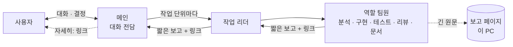
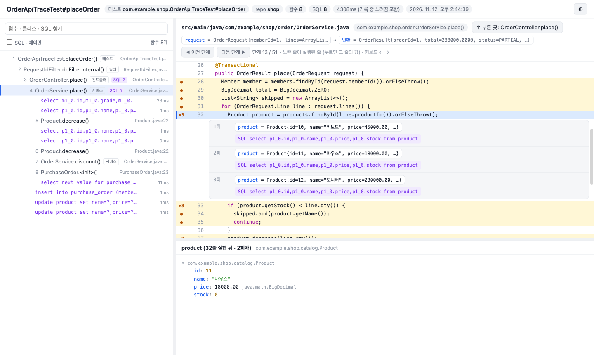
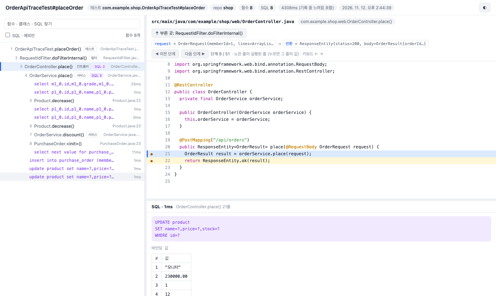

# kedovi AI 협업 워크스페이스 킷

**AI 에이전트로 팀 개발할 때, 모두가 같은 규칙으로 일하고 누구든 이어받게 해 주는 협업 워크스페이스 킷**

[](https://github.com/evrenjo/kedovi/actions/workflows/ci.yml)


[](https://evrenjo.github.io/kedovi/)
[](LICENSE)

> 🚧 **개발 중 (0.x)**: 개인 작업에 쓰려고 만든 도구를 공개한 것입니다. 정식 버전 전까지는 명령 · 설정 형식이 예고 없이 바뀔 수 있고, 바뀐 내용은 [변경 기록](CHANGELOG.md)에 버전마다 남깁니다.
>
> ⚠️ **사용 책임**: 쓰다가 생기는 문제(파일 · 데이터 손실, AI 사용 요금, 보안 사고 등)는 책임지지 않습니다 ([MIT 라이선스](LICENSE)의 「있는 그대로」 조건). AI 에이전트가 파일을 고치고 명령을 실행하므로, 중요한 저장소에서는 커밋 · 백업을 해 두고 쓰세요.

### 문서 사이트

**https://evrenjo.github.io/kedovi/**

- 문서 원본은 md(`README.md` · `docs/*.md`)이고, `npm run docs` 가 기획 문서 사이트와 같은 생성기(`kedovi docs build`)로 `docs-site/` 를 만든다.

프로젝트마다 git repo 하나로 된 **워크스페이스**를 세우면, 누가 어느 PC 에서 Claude Code 나 Codex 를 켜도 같은 규칙으로 일하고, 한 일이 기록으로 남아 다음 사람이 바로 이어받는다.

### 에이전트가 일하고 대화하는 방식

워크스페이스의 규칙 · 훅이 Claude Code · Codex 에이전트를 아래처럼 움직인다. 문장으로 적은 규칙은 훅이 멈출 때 · 고칠 때 다시 확인한다.



| 장면 | 에이전트가 하는 것 |
|---|---|
| 일을 맡길 때 | 메인은 사용자와 대화만 하고, 파일 수정은 한 줄이어도 백그라운드 에이전트에 맡긴다. 그래서 작업 중에도 대화가 끊기지 않고, 그 사이 보낸 메시지는 처리했는지 멈출 때 다시 확인한다 |
| 크게 나눌 때 | 독립인 작업 단위마다 작업 리더를 두고, 리더가 역할 팀원을 불러 함께 돌린다. 동시 수는 요금제 여유에 맞춘 상한 안에서 |
| 시작하기 전 | 코드를 고치기 전에 「착수 전 확인」(무엇을 · 어디까지 · 어떻게 검증)을 먼저 보인다 |
| 답할 때 | 질문이면 첫 줄에 답부터. 채팅은 결론 · 핵심 3~5줄 · `자세히: <링크>` 만 쓰고, 바뀐 파일 · 검증 표 · 근거는 이 PC 의 보고 페이지로 옮긴다. 리더 · 팀원의 긴 보고도 훅이 페이지로 보관해 받는 쪽에는 짧게 간다 |
| 완료라고 할 때 | 근거(확인됨 · 추정 · 미확인)와 실제로 돌린 검사 결과 표로 말한다. 구현 → 검사 → 리뷰 → 수정 → 검사 순서 |
| 정할 것이 생길 때 | 선택지가 있는 결정은 질문 창으로 하나씩 묻는다. 커밋 · push · 배포 · DB 반영은 승인 뒤에만 |
| 기다리며 멈출 때 | 「지금 도는 것 · 예상 종료 · 사용자가 할 일」 한 줄을 남긴다. 대기로 남은 팀원 · 열어 둔 브라우저는 정리하라고 훅이 짚는다 |
| 세션을 마칠 때 | 한 일 · 진행 중 · 남은 일을 핸드오프로 남겨 다음 세션 · 다른 사람이 이어 간다 |

> 처음이면 [빠른 시작](docs/quickstart.md) 부터. 문서를 브라우저로 보려면 위 「문서 사이트」 주소를 열거나 킷 repo 를 clone 했으면 `docs-site/index.html` 을 연다.

### 화면

**문서 사이트**: 기획 repo 의 md 를 검색 · 목차 · 흐름도가 있는 사이트로 만든다 (그림은 이 킷의 문서).


**데이터 설계 (ERD)**: md 테이블 정의서에서 ERD 를 그린다. 영역 · 스키마로 거르고 SQL DDL · SVG · PDF 로 내보낸다.


**화면설계서**: 같은 양식 · 같은 뷰어. 번호 마커와 설명, 근거 ID 가 기능 정의로 이어진다.


### 해결하는 문제

| 팀에서 AI 를 쓰면 생기는 일 | kedovi 에서는 |
|---|---|
| 사람마다 프롬프트·규칙이 달라 결과 품질이 제각각이다 | 규칙·스킬·훅을 워크스페이스 repo 에 한 벌 두고 모두가 같은 것을 쓴다 |
| 세션이 끝나면 AI 가 하던 일을 잊는다 | 작업을 마칠 때 **핸드오프**로 한 일·진행 중·남은 일을 남기고, 다음 세션이 **재개**로 이어 간다 |
| 누가 무엇을 어디까지 했는지 모른다 | **팀 현황**이 모두의 기록을 모아 보여 주고, 빠진 사람의 일은 **인수인계**로 넘겨받는다 |
| AI 가 처음부터 계획을 크게 세우고 한꺼번에 만든다 | **진행 방식 스프린트**(신규 · 고도화 기본): 기능 단위 스프린트로 끝까지 동작하는 최소 기능부터 만들고, 스프린트마다 데모 · 회고하며 백로그에서 하나씩 붙인다. 전체 설계가 산출물인 차세대 · 분석·설계는 **전체**, 이슈마다 운영에 반영하는 운영 · 유지보수는 **이슈형**(이슈 보드) (`kedovi approach`) |
| 긴 작업에서 전체 중 어디까지 왔는지 안 보인다 | **로드맵**(`handoffs/PLAN.md`)이 단계 흐름 · 지금 단계 표 · 이번에 생긴 것 · 다음을 그린다. 단계를 끝낼 때마다 보고에 붙는다 |
| 기획 문서와 화면설계서가 사람마다 양식이 다르고, 근거를 찾아 문서를 뒤진다 | **문서 사이트**(`kedovi docs build`)가 기획 repo 의 md 를 HTML 로 만들고 ID 마다 앵커를 단다. **화면설계서**는 같은 양식 · 같은 뷰어로, 근거 ID 를 누르면 옆에 그 정의가 열린다. **데이터 설계**는 md 테이블 정의서에서 ERD 를 만든다 |
| AI 작업이 한 줄로 차례차례 돌아 느리다 | 서로 독립인 일은 **작업 리더**마다 나눠 함께 돌린다 (메인 → 작업 리더 → 팀원). 요금제에 맞춰 동시 수를 정해 사용량이 한꺼번에 녹지 않게 한다 |
| Claude 파, GPT 파로 도구가 갈린다 | Claude Code · Codex 를 같은 규칙으로 쓰고, 역할마다 두 회사 모델을 **섞어** 쓴다 |
| "된다" 고 했는데 안 된다 | AI 가 근거(확인됨 · 추정 · 미확인)와 **실행한 검증 결과(표)** 로 보고한다 |
| "보통은 이렇게 한다" 가 AI 기억이라 낡거나 틀린다 | 흔한 방식 · 업계 관례는 **웹 검색으로 출처를 확인해 비교표로** 답한다 (`common-practice` 스킬). 검색할 수 없으면 "내 지식 기준" 이라고 밝힌다 |
| 규칙을 문서에 써 두면 지켜지지 않는다 | 중요한 규칙은 **검사 도구**(훅 · pre-commit · 스택별 검사)로 강제한다 |
| 코드가 실제로 어떤 값으로 도는지 보려면 IDE 디버거를 붙여 한 줄씩 따라가야 한다 | **실행 흐름 디버깅**: "주문 API 디버깅 보여줘" 한마디에 테스트 · 로컬 요청 한 번을 기록해, 지나간 함수 · 줄마다 값 · SQL 을 웹 페이지로 보여 준다 (`trace` 팩) |

### 추구하는 방향

1. **규칙은 한 벌, 도구는 둘.** 정본(`packs/` · `workspace.json`)을 고치면 Claude Code 용과 Codex 용 파일을 킷이 함께 만든다.
2. **기록이 곧 협업.** AI 와 한 일은 대화창이 아니라 워크스페이스 repo 의 `handoffs/` 에 남아 팀 전체가 본다.
3. **말보다 검사.** 사고에서 배운 규칙은 문장보다 훅·pre-commit·검사 도구로 남긴다.
4. **근거로 말하는 AI.** 추측을 사실처럼 말하지 않고, 완료는 실행한 검증으로 말한다.
5. **결정은 사람이.** 커밋·push·배포·DB 반영은 사용자 승인 뒤에만 한다. AI 서명은 붙이지 않는다.

### 구조 한눈에

```tree
GitLab · GitHub 그룹
├─ order       ← 워크스페이스 repo (규칙 · 스킬 · 팀 설정 · handoffs/ 를 모두 공유)
├─ order-api   ← 개발 repo
└─ order-web   ← 개발 repo

각자 PC 의 order/ (워크스페이스를 clone)
├─ workspace.json          ← 팀 설정 원본: repo 목록 · 팩 · 유형 · 모델
├─ AGENTS.md · CLAUDE.md   ← 두 도구가 읽는 같은 규칙 (자동 생성)
├─ bin/kit.js · packs/     ← 생성 엔진 · 규칙 · 스킬 · 훅 사본 (kedovi upgrade 가 갱신)
├─ handoffs/<이름>/        ← 내 작업 기록, push 로 팀 공유
├─ handoffs/PLAN.md        ← 로드맵 (팀 공용)
├─ docs-site/              ← (선택) 워크스페이스 문서 사이트 (아래 표)
└─ repos/                  ← 각자 kedovi install 로 받는다 (git 제외, 이력은 원래 repo 로)
   ├─ order-api            ← clone
   ├─ order-plans          ← 기획 repo: clone 또는 로컬 폴더 링크
   └─ order-batch          ← 새로 만든 repo (git init, 원격 없음)
```

문서 사이트는 채팅으로 말하면 에이전트가 `kedovi docs` 명령으로 만든다.

| 이럴 때 | 이렇게 말한다 | 하는 일 |
|---|---|---|
| 기획 문서 · 화면설계서 · ERD 를 볼 때 (모든 유형) | "문서 사이트 만들어줘" | `kedovi docs build`: 기획 repo 의 `docs-site/` |
| 여러 repo 의 산출물을 한 사이트로 (분석·설계 · repo 가 많은 프로젝트) | "워크스페이스 문서 사이트 만들어줘" | `kedovi docs build .`: 워크스페이스 `docs-site/`. repo 마다 사본 · 링크 · 뺌은 `docs-site.json` |
| 내 PC 에서 바로 볼 때 | "문서 사이트 열어줘" | `kedovi docs serve --open` |
| 팀이 주소로 볼 때 | "문서 사이트 Pages 로 올려줘" | `kedovi docs pages on`: GitLab · GitHub Pages |

### 하루의 협업 모습

| 누가 · 언제 | 하는 것 | 일어나는 일 |
|---|---|---|
| 리더 · 처음 한 번 | `kedovi init` → push | 유형 · 개발 repo · 스택 · 팀 모델을 고르면 워크스페이스가 만들어진다 |
| 팀원 · 처음 한 번 | clone → `kedovi install` | 개발 repo 가 `repos/` 에 받아지고 팀 합류 기록이 올라간다 |
| 모두 · 아침 | `kedovi start` → "재개" | 로드맵(흐름도 · 지금 단계 표)과 어제 내 핸드오프가 뜨고, 이어서 할 일을 보고받는다 |
| 모두 · 작업 중 | "주문 목록에 페이지네이션 추가해줘" | 큰 일은 분석 · 설계 · 구현 · 테스트 · 리뷰 역할로 나눠 계획을 먼저 보여 주고 진행한다. 리뷰는 다른 회사 모델이 본다 |
| 모두 · 작업 끝 | "핸드오프" | 한 일 · 진행 중(작업 브랜치) · 남은 일이 기록돼 push 된다 |
| 리더 · 수시로 | `kedovi team` 또는 "팀 현황" | 누가 언제 무엇을 얼마나 했는지, 며칠째 멈춘 사람은 누구인지 본다 |
| 누구나 · 필요할 때 | "인수인계 이개발" | 그 사람의 미완 작업 · TODO 를 골라 내 것으로 옮기고, 작업 브랜치에서 이어 간다 |

### 주요 특징

기능 묶음마다 이 킷에만 있는 것을 모았다. 명령은 모두 채팅에서 말로도 된다 ("팀 현황 보여줘" · "FN-001 어디서 써?").

#### 팀 에이전트 · 병렬 작업

| 기능 | 내용 |
|---|---|
| 메인은 대화 전담 | 메인은 사용자와 대화하고, 파일 수정은 한 줄이어도 백그라운드 에이전트에 맡긴다 (작은 수정은 지금 대화를 이어받는 사본). 작업 중에 보낸 메시지를 놓치지 않게, 멈출 때 훅이 그 사이 들어온 메시지를 처리했는지 되묻는다 |
| 3층 팀 (메인 → 작업 리더 → 팀원) | 서로 독립인 작업 단위(이슈 · 기능 · 문서 영역 · 테스트 영역)가 여럿이면 단위마다 작업 리더를 두고, 리더가 역할 팀원을 불러 함께 돌린다. 기획 · 개발 · 테스트 단계별 구성이 정해져 있다 |
| 요금제에 맞춘 상한 | 이 PC 의 Claude 요금제 여유도로 리더 수 × 리더당 팀원 수가 정해진다 (빠듯 1×2 · Max 2×2 · 넉넉 3×2 · Ultra · 종량 4×3). 훅이 층별로 세어 넘으면 막는다 |
| 짧은 답 · 자세히는 링크 | 긴 보고는 이 PC 의 웹 페이지(현황판 틀)로 옮기고 채팅은 결론 · 핵심 · `자세히: <링크>` 만. 길게 쓰면 훅이 한 번 되돌린다. 리더 · 팀원의 긴 보고는 훅이 원문을 페이지로 보관하고 짧게 다시 쓰게 해, 메인 맥락도 덜 찬다 |
| 진행 보기 | `kedovi agents watch` 가 메인 → 작업 리더 → 팀원을 나무로 그리고 각자 지금 하는 일(마지막 행동)을 보여 준다. 팀원 tmux 창은 `kedovi team watch`, 실제 상태(일하는 중 · 대기 · 종료됨)는 `kedovi team` |
| 같은 repo 를 여럿이 동시에 | 리더마다 작업 폴더(`kedovi worktree`)를 주고, 끝나면 본 작업 트리에 커밋하지 않은 변경으로 옮긴다. 겹치면 멈춘다 |
| 역할 에이전트 | 분석 · 설계 · 설계 문서 · 구현 · 테스트 · 리뷰 · 문서화 + 팩 · 프로젝트가 더한 역할. **자동** 모드면 리더가 작업마다 역할 · 등급 · 모델을 골라 구성을 한 줄로 알리고 시작한다 |
| Claude · GPT 섞어 쓰기 | 역할마다 두 회사 모델을 나눠 쓴다 (예: Claude 가 구현, GPT 가 리뷰). 상대 도구에 맡긴 작업은 `kedovi delegate watch` 로 줄마다 본다 |
| 토론 모드 | 여러 모델(다른 회사 포함)이 따로 보고 서로 반박한 뒤 합의 · 갈림 · 기각으로 정리한다. 회차마다 채팅에 중계 |

#### 한 규칙, 두 도구

| 기능 | 내용 |
|---|---|
| Claude Code · Codex 겸용 | 정본(`packs/` · `workspace.json`) 한 벌에서 두 도구용 규칙 · 스킬 · 훅 · 역할 파일을 만든다 |
| repo 마다 맞는 규칙 | 스택 80종 · 언어를 감지해 repo 마다 규칙을 붙인다 (Spring 은 서버, React 는 화면). 멀티모듈은 모듈별. repo 안의 자체 지침(CLAUDE.md · AGENTS.md)도 찾아 따를지 정한다 |
| 프로젝트 유형 | 신규 구축 · 차세대 · 운영·고도화 · 분석·설계 마다 근거와 규칙이 다르다. 분석·설계 → 구축처럼 바뀌어도 같은 워크스페이스에서 `kedovi type` |
| 설정으로 규칙 고르기 | 규칙 머리말 `if: vars.키=값` 으로 프로젝트 설정에 맞는 규칙만 켠다 (예: 백엔드 구조 component-web) |
| 응답 언어 · 대화 스타일 | 한국어 · English, 학습 · 일반 · 전문가. 긴 작업 중에도 고른 언어를 지킨다 |

#### 기록 · 인수인계 · 진행

| 기능 | 내용 |
|---|---|
| 핸드오프 · 재개 · 인수인계 | 한 일 · 진행 중 · 남은 일을 `handoffs/` 에 남기고, 다음 세션이 이어 간다. 빠진 사람의 TODO 를 골라 넘겨받는다 |
| 팀 현황 · 현황판 | 누가 언제 무엇을 얼마나 했는지, 멈춘 사람, 지금 도는 작업 리더 · 팀원 수 (`kedovi team` · `kedovi board`) |
| 로드맵 · 진행 방식 | MVP · 스프린트 · 워터폴 · 이슈형. 단계 흐름도 · 영역 × 하위 작업 표 · 완료 n / 전체 N (숫자는 git 기록에서 센다). 다 끝나면 다음 유형을 알린다 |
| 팀장 · 담당 repo | 담당 아닌 repo 수정을 훅 · pre-commit 이 막는다. 설정 잠금은 팀장만 푼다 |
| 텔레그램 알림 | 개인(작업 끝 · 결정 질문 · 양방향 대화) · 팀 방(핸드오프 · 로드맵 · 공지) |

#### 기획 · 문서

| 기능 | 내용 |
|---|---|
| 기획 repo 뼈대 | 개요 → 시스템 구성 → 기능(요구 목록 · 수용 기준) → 화면 → 데이터 · API → 결정 순서. 규모 문서(지금 · 1년 · 3년)까지 |
| 문서 사이트 | 기획 repo 의 md → 검색 · 목차 · 흐름도가 있는 사이트. 정의 ID 마다 앵커, 근거 색인, GitLab · GitHub Pages |
| 화면설계서 · ERD | 같은 양식 · 같은 뷰어(발표 · A4 인쇄 · 근거 패널). md 테이블 정의서 → ERD (SQL DDL · SVG · PDF) |
| 기획 ID 추적 | 코드의 `@spec` 주석으로 기능 · 화면 · API ID 를 잇고, 테스트에 없는 수용 기준 · ID 없는 새 진입 파일을 알린다 |

#### 화면 개발: 정본과 대조

| 기능 | 내용 |
|---|---|
| 화면 정본 판정 | 프로토타입 > 화면설계서. 둘 다 있고 다르면 · 둘 다 없으면 묻는다. 화면의 모양 · 배치는 정본이 디자인 시스템 · 기존 화면보다 먼저 |
| 위치 설정 | `kedovi screens locate` 가 기획 repo 의 화면 폴더 · 프로토타입을 찾아 알리고, 한 페이지 앱 프로토타입은 주소 틀(`index.html#{id}`)로 화면마다 연다 |
| 착수 전 확인 | 정본이 있는 화면의 진입 파일을 체크리스트 없이 고치면 훅이 막는다. 구현 · 리뷰 지시서에 정본 블록이 자동으로 들어간다 (구현: 정본대로, 못 하면 멈춤 · 리뷰: 빠진 요소 = 블로커) |
| 요소 체크리스트 | `kedovi screens inventory <화면 ID>` 가 정본의 요소를 뽑아, 요소마다 구현 · 다름(이유) · 뺌(결정 ID) · 보류(후속 위치) 판정을 남긴다. 계약 · 데이터 원천 · 범위 때문에 다르면 사용자 결정 ID 가 있어야 통과 |
| 나란히 비교 · 배치 대조 | `kedovi screens compare --mock` 으로 백엔드 없이 정본과 구현을 같은 폭으로 찍고, 영역 배치(옆 · 아래 · 폭)가 바뀐 곳을 찾아 판정 대상으로 넣는다 |

#### 실행 흐름 디버깅 (`trace` 팩)

API · 함수 · 배치 한 번이 **어떤 값으로 들어와 어느 함수를 거치고, 줄마다 값이 어떻게 바뀌고, 어떤 SQL 로 무엇을 조회했는지**를 IDE 디버거처럼 웹 페이지로 본다. 프로젝트 코드는 고치지 않는다 (디버그 포트로 붙어 기록).

| 채팅에서 이렇게 말하면 | 에이전트가 하는 것 |
|---|---|
| "주문 API 디버깅 보여줘" · "`POST /api/orders` 실행 흐름 보여줘" | 그 경로의 컨트롤러를 찾아 테스트 한 건으로 기록 |
| "`OrderService.place` 어떻게 도는지 보여줘" · "정산 배치 흐름 보여줘" | 그 함수 · 배치를 부르는 테스트로 기록 (없으면 기록용 테스트를 만들고 알린다) |
| "주문 API 로컬 데이터로 디버깅 보여줘" | 로컬 서버를 띄워 실제 요청 한 번을 기록하고 서버를 끈다 |
| "지난 디버깅 기록 보여줘" | 최근 기록 목록 (`kedovi trace list`) |

답은 흐름 요약 몇 줄과 `자세히: <링크>` 이고, 링크를 누르면 이 PC 의 브라우저에서 아래 화면이 열린다.



| 자리 | 보이는 것 |
|---|---|
| 왼쪽 | 탄 함수를 실행 순서대로 들여 써서: 필터 → 컨트롤러 → 서비스 → 저장소 · 배치 꼬리표, 그 자리에서 나간 SQL · 예외 |
| 오른쪽 위 | 고른 함수의 소스와 인자 · 반환값. 실행된 줄은 노란색(×3 = 세 번). 줄을 누르면 회차마다 그 줄 실행 뒤 바뀐 값 · 부른 함수 · SQL. 「이전 · 다음 단계」(← →)로 한 줄씩 |
| 오른쪽 아래 | 데이터 상세: 고른 값의 객체 나무, SQL 문 · 바인딩 값 · 걸린 시간 |



| 항목 | 내용 |
|---|---|
| 켜기 | `kedovi upgrade --add trace` (선택 팩) |
| 직접 실행 | `kedovi trace run --test <테스트 클래스>#<메서드>` · `kedovi trace run --request "POST http://localhost:8080/api/orders" --data '{…}'` · `kedovi trace list` · `kedovi trace open` |
| 지원 | JVM(Java · Kotlin, Gradle · Maven, Spring Boot 2 · 3 · 4). 다른 언어는 다음 단계 |
| 안전 | 값은 필드만 읽어 실행을 바꾸지 않는다 (JPA 지연 로딩 그대로). 비밀번호 · 토큰 이름의 값은 `***`. 서버는 localhost 만. 기록은 이 PC 의 `.agents/traces/`(커밋 안 함) |
| SQL | Gradle 은 기록할 때만 datasource-proxy 를 붙인다 (빌드 파일 안 고침). Maven 은 pom 에 있어야 보인다 |
| 한계 | 줄마다 멈추므로 평소보다 느리다 (테스트 한 건 · 요청 한 번 크기). 다른 스레드로 넘어가는 비동기 흐름은 아직 |

자세히: [실행 흐름 디버깅](docs/trace.md)

#### 검증 장치: 말보다 검사

| 기능 | 내용 |
|---|---|
| 훅으로 지키는 규칙 | 코드 수정 전 착수 전 확인 · 리뷰 전 검사 통과 줄 · 팀원 git 안전장치(루트 repo · push 막기) · 비밀값 커밋 막기 · 오래 일하는 팀원 · 대기 팀원 알림 · 결정 질문 형식 |
| 구조 검사 템플릿 | `kedovi archrules` 가 Spring(ArchUnit) · React · NestJS(dependency-cruiser) · FastAPI · Django(import-linter) 의존 방향 시험을 repo 에 넣는다. 백엔드 화면 API 폴더 ↔ 프론트 화면 폴더 대조 (`kedovi views check`) |
| 쓰기 보고서 | 시험이 DB 에 쓴 테이블 · 컬럼 · 값을 DB 화면처럼 보이고, 기능 문서 「저장」 표와 대조한다 |
| 외부 API 장부 · 극값 | 외부 API 동작 장부와 실패 주입 세트(429 · 지연 · 빈 응답), 운영 DB 집계로 칸 길이 · 극값 fixture |
| 테스트 인프라 관례 | 실제 엔진(DB · 브로커 · 캐시) 컨테이너를 실행당 한 벌 · 쓰는 것만 · 공유하면 격리. 시험 피라미드 |

#### 운영 · 배포

| 기능 | 내용 |
|---|---|
| 배포 전 판정 · 배포 | `kedovi release`: 같은 트리 성공 · CI 설정 그대로 · 확인 명령 → release MR → 머지 → 배포 파이프라인 |
| GitLab 다루기 | 파이프라인 기다리기 · 머지 · 수동 작업 실행 · 재시도, 러너 디스크 · 대기열 경보 |
| 운영 점검 | 배포 수명 시험 · 수명 경보 · 배포 전 점검, 운영 결함 기록(발견 · 해소 시간) · 시간 예산 월간 집계 |
| PC 자원 | Claude Code 세션 · MCP · 남은 브라우저 메모리 합계 경고(`kedovi doctor` 「메모리」), 브라우저 MCP 는 필요한 역할에만 붙이고 쓰고 나면 닫게 검사 |

#### 모델 관리

| 기능 | 내용 |
|---|---|
| 근거 있는 추천 | 실행 도구별 × 최고 · 표준 · 절약 프로필. 독립 벤치마크(LiveBench) 분야별 점수로 고른다 |
| 새 모델 · 퇴역 알림 | 주 1회 점검이 새 모델 · 퇴역 · 요금제 변경을 알리고, 낡은 모델은 `kedovi models --migrate` 로 바꾼다. AI 게이트웨이도 지원 |

## 설치 (PC 마다 1번)

npm 공개 저장소에서 받는다. macOS 터미널 · Windows PowerShell 모두 같은 명령이다.

```bash
node -v                      # v20.19 이상
npm i -g kedovi
kedovi --version
```

처음 실행할 때 kedovi 은 Node 버전과 상관없는 고정 위치에 실행 파일을 두고 PATH 에 넣는다. 그래서 nvm 등으로 기본 Node 를 바꾸거나 설치했던 버전을 지워도 `kedovi` 명령은 그대로 동작한다 (여러 Node 버전에 깔려 있으면 버전이 가장 높은 kedovi 을 쓴다. Windows 는 지금 Node 에 깔린 것을 먼저). 새 터미널부터 적용된다.

| PC | 실행 파일 | PATH |
|---|---|---|
| macOS · Linux | `~/.local/bin/kedovi` | 셸 설정(`~/.zshrc` · `~/.bashrc` 등)에 한 줄 |
| Windows | `%LOCALAPPDATA%\kedovi\bin\kedovi.cmd` | 사용자 PATH |

> 참고: 끄려면 환경 변수 `KEDOVI_NO_GLOBAL_SHIM=1`. 넣은 줄은 `# kedovi:` 표시가 붙어 있어 지울 때 찾기 쉽다.

### 권한 오류 (EACCES)

설치가 `EACCES: permission denied, mkdir '/usr/local/lib/node_modules/…'` 로 실패하면, 전역 설치 폴더의 주인이 지금 계정이 아니다. 예전에 `sudo npm i -g` 를 한 번 썼거나, Node · Homebrew 를 다른 계정이나 공식 설치 파일(.pkg)로 깐 경우다. 킷 문제가 아니라 npm 이 패키지를 받기 전에 난 오류다.

원인 확인:

```bash
which node npm
ls -ld "$(npm config get prefix)/lib/node_modules"   # 주인이 지금 계정(whoami)이 아니면 이 경우
```

| 방법 | 관리자 암호 | 명령 | 맞는 경우 |
|---|---|---|---|
| 전역 설치 위치를 홈 폴더로 (권장) | 필요 없음 | 아래 「홈 폴더로」 | 누구 PC 든, 원인이 무엇이든 |
| 폴더 주인을 내 계정으로 | 한 번 | `sudo chown -R "$(whoami)" "$(npm config get prefix)/lib/node_modules" "$(npm config get prefix)/bin"` | 내 PC 이고 `sudo npm i -g` 를 쓴 것이 원인일 때 |
| 설치 없이 실행 | 필요 없음 | `npx <패키지>@latest <명령>` | 잠깐 써 볼 때 (매번 `npx` 를 붙인다) |

홈 폴더로 (macOS · Linux, 셸이 bash 면 `~/.zshrc` 대신 `~/.bash_profile`):

```bash
mkdir -p ~/.npm-global
npm config set prefix ~/.npm-global
echo 'export PATH="$HOME/.npm-global/bin:$PATH"' >> ~/.zshrc
source ~/.zshrc
```

그다음 위 설치 명령(`npm i -g …`)을 다시 실행한다. `sudo npm i -g` 로 설치하지 않는다: 설치는 되지만 업데이트와 킷이 만드는 파일에서 같은 오류가 다시 난다.

Claude Code(`npm i -g @anthropic-ai/claude-code`) 나 Codex(`npm i -g @openai/codex`) 중 쓸 것도 설치돼 있어야 한다. Codex 앱만 깔아 터미널에 `codex` 명령이 없어도, 앱이 내려받은 CLI(`~/.codex/packages/*/current`)를 찾아 쓴다.

### 플러그인 · MCP · 도구

워크스페이스를 제대로 쓰려면 아래를 PC 마다 한 번 설치한다. `kedovi doctor` 가 같은 목록으로 빠진 것을 알린다.

| 구분 | 항목 | 설치 | 쓰는 기능 |
|---|---|---|---|
| 필수 | Node.js 20.19+ · git | `node -v` · `git --version` | 전부 |
| 필수 | Claude Code 또는 Codex (최신) | `npm i -g @anthropic-ai/claude-code` · `npm i -g @openai/codex` | 에이전트. Haiku 5.5 는 Claude Code 2.1.293 이상 |
| 필수 (팀) | 저장소 로그인: GitHub `gh` · GitLab `glab` · 또는 SSH 키 | `gh auth login` · `glab auth login` | 이 PC 사용자 확인(팀장 · 담당 repo), MR · PR 스킬 |
| 권장 | claude-mermaid (Claude Code 플러그인) | `kedovi prefs mermaid install` | 대화 중 그림을 브라우저로 |
| 권장 (화면 개발) | Playwright MCP | `claude mcp add playwright -- npx @playwright/mcp@latest` | 화면 확인 · 접근성 검사 (stack-react 실행 검사) |
| 선택 | telegram 플러그인 + bun | `kedovi notify my channel on` (안내에 따라) · `curl -fsSL https://bun.sh/install \| bash` | 텔레그램 양방향 대화 |
| 선택 | pixel-agents | `npm i -g pixel-agents` | 팀원 작업을 캐릭터 화면으로 (`kedovi start --pixel-agents`) |

Codex 는 따로 넣을 플러그인이 없다. 팀이 함께 쓰는 MCP 서버는 `workspace.json` 의 `mcp` 에 적으면 `.mcp.json` · `.codex/config.toml` 에 함께 들어간다.

설치가 끝나면 [빠른 시작](docs/quickstart.md)의 「팀 리더: 워크스페이스 생성」 또는 「팀원: 합류」 로 간다. 선택 화면마다 무엇을 묻고 어디에 저장하는지는 [업무 흐름](docs/workflow.md).

### 인증

repo 마다 토큰이 필요하지 않다.

- clone 은 kedovi 가 아니라 **git 이 저장해 둔 인증**을 쓴다 (macOS 키체인·Git Credential Manager·SSH 키). **호스트마다 한 번** 인증해 두면 그 호스트의 repo 는 모두 받아진다.
- 인증이 없으면 clone 이 멈추지 않고 바로 실패하며 "인증 필요" 를 알린다 → 그 주소로 `git clone` 을 한 번 직접 해서 인증을 저장한 뒤 `kedovi install`.
- MR·PR 을 만드는 스킬 · 파이프라인 조회만 따로 토큰이 필요하다. GitLab 은 `kedovi secret set GITLAB_TOKEN`([비밀값](docs/workspace.md#비밀값-토큰)), GitHub 은 `gh auth login`.

## 시작 유형 (SI 분류)

| 유형 | 에이전트가 삼는 근거 | 필요한 repo | 자동으로 들어가는 팩 |
|---|---|---|---|
| **신규 구축** `new` | 기획 문서(요구사항) | 기획 문서 | 없음 |
| **차세대** `modernization` | 요구사항 > AS-IS 소스 > 현재 코드 | 레거시 소스 (없으면 sync 가 멈춤) | `modernization`: AS-IS 대조 규칙·도구 |
| **운영·고도화** `enhancement` (SM 포함) | 현재 코드(지금 동작) + 개선 요구사항·이슈 티켓(바뀔 동작) | 운영 중인 시스템 코드 | `enhancement`: 기존 동작 보존·변경 영향 점검 상시·회귀 방지·운영 환경 조회만·hotfix |
| **분석·설계(ISP·ISMP)** `consulting` | 현행 시스템·업무 자료 → 결과물은 문서 | 산출물 문서 (현행 소스는 선택) | `consulting`: 코드 수정 없음·근거 표기·`requirements` 스킬 |

**이슈·티켓 처리는 모든 유형 공통이다.** 구축 중 QA·UAT 지적이든 운영 중 장애든 `ticket` 스킬과 공통 규칙(재현 먼저 · 최소 변경 · 티켓 번호 · 조치 보고 5칸)으로 처리한다.

여러 시스템을 하나로 합치는 통합구축은 **차세대에 레거시 repo 를 여러 개** 등록해 쓴다.

## 문서 안내

| 알고 싶은 것 | 문서 |
|---|---|
| 처음 따라 하기 (유형별) | [빠른 시작](docs/quickstart.md) |
| 선택 화면 · 저장 위치 흐름도 | [업무 흐름](docs/workflow.md) |
| 모든 명령 | [명령](docs/commands.md) |
| 핸드오프 · 재개 · 인수인계 · 로드맵 | [인수인계](docs/handoff.md) |
| 기획 문서 사이트 · 화면설계서 · 데이터 설계 | [문서 사이트](docs/docs-site.md) |
| 텔레그램 알림 | [알림](docs/notify.md) |
| 역할별 모델 · Claude · GPT 혼용 | [팀 에이전트와 모델](docs/team-models.md) |
| `workspace.json` · 비밀값 · 설정 수정 권한 | [workspace.json · 설정](docs/workspace.md) |
| 규칙이 붙는 방식 · 켜고 끄기 | [규칙](docs/rules.md) |
| 팩 목록 · 만들기 | [팩 종류](docs/packs.md) · [팩 제작](docs/pack-making.md) |
