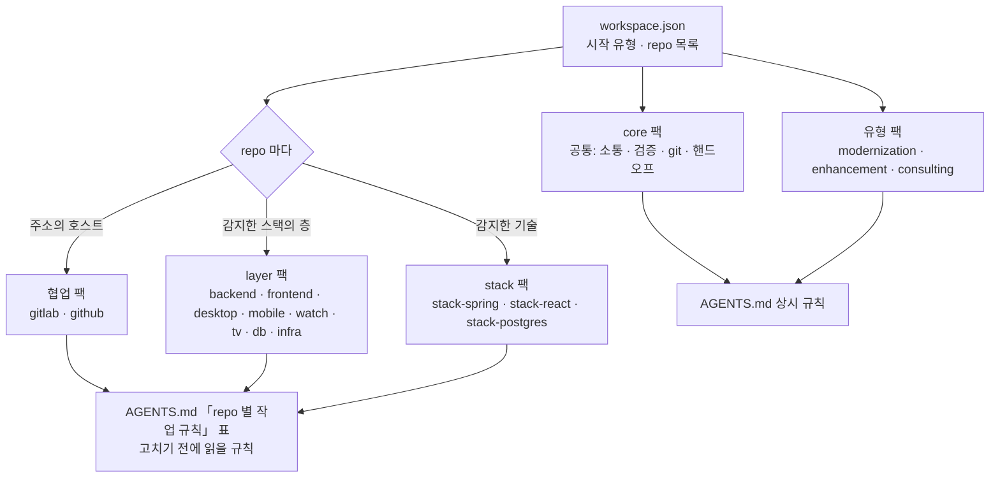

# 규칙

## 규칙이 붙는 방식

스택은 repo 마다 정해진다.

기술 스택은 **고르는 것이 아니라 감지한다.** repo 를 clone 한 뒤 파일(`build.gradle`, `package.json`, `pyproject.toml`, 설정 파일 등)을 보고
repo 마다 스택을 정하고, 사람이 확인·수정한다. 결과는 `workspace.json` 의 `repos[].stacks`.



- 협업 팩은 repo 마다 주소로 판단한다 (GitHub repo 와 GitLab repo 를 섞어 써도 된다).
- layer 팩은 그 층의 스택이 있는 repo 에 자동으로 붙는다 (기술과 무관한 공통 원칙). stack 팩은 그 기술인 repo 에만 붙는다.

AGENTS.md 에는 **"repo 별 작업 규칙" 표**가 생긴다. repo 마다 스택과 "고치기 전에 읽을 문서". 킷에 전용 팩이 없는 스택
(Angular·FastAPI·MySQL 등)은 **"전용 규칙 없음"** 으로 표시되고 layer 공통 규칙만 받는다. 스택 규칙이 repo 단위라 repo 가 10개여도
AGENTS.md 가 거의 커지지 않는다.

**멀티모듈 repo**: 한 repo 에 `api/`(Spring)·`client/`(React) 처럼 모듈을 나눠 두면 스택마다 모듈을 기록한다 (빌드 파일이 있는 가장 가까운 폴더 기준, 깊이 4까지).
표에 `Spring (api/) · React (client/)`, 규칙마다 `` : `api/` `` 가 붙어 에이전트는 고치는 모듈의 규칙만 읽는다.
이 기능 전에 만든 워크스페이스는 `kedovi upgrade` 가 모듈 경로를 채운다.

**간접 의존**: 사내 라이브러리(예: 사내 스타터)가 프레임워크를 전이 의존으로 끌어오면 빌드 파일에 프레임워크 이름이 없다.
Spring 은 빌드 파일 외에 Spring Boot 설정 파일(`application[-프로필].properties·yml` 의 최상위 `spring` 키)과 소스의 `@SpringBootApplication` 으로도 잡는다.
그래도 못 잡으면 감지 결과에 "빌드 파일은 있습니다" 가 나온다. 그 라이브러리 좌표를 힌트로 한 번 적어 두면 팀 전원의 다음 감지부터 자동이다.

```bash
kedovi detect --hint spring --contains 'com\.example\.platform:platform-starter'   # workspace.json stackHints 에 저장 → 다시 감지 → sync
```

감지하는 스택은 80종이다 ([팩 종류](packs.md)의 스택 목록).

| 분류 | 스택 |
|---|---|
| 서버 | Spring (+ 세부 27종: MVC · WebFlux · Batch · Cloud Gateway · Stream · Integration · GraphQL · Kafka · Modulith …), FastAPI, Django, Flask, Express, NestJS, ASP.NET, Go |
| 웹 | React, Angular, Vue, Svelte |
| 데스크톱 | Electron, Tauri, Neutralino, WPF, WinForms, WinUI, Avalonia, JavaFX, Qt, Flutter Desktop, Compose Desktop, macOS 네이티브 |
| 모바일 · 워치 · TV | Android, iOS, Flutter, React Native(Expo), .NET MAUI, Kotlin Multiplatform, Capacitor·Ionic, Cordova, NativeScript / watchOS, Wear OS / tvOS, Android TV, Tizen, webOS |
| 인프라 | Docker, Docker Compose, Kubernetes(Helm), Terraform·OpenTofu, Ansible |
| DB | PostgreSQL, MySQL·MariaDB, Oracle, SQL Server, MongoDB |

공통 규칙 팩은 모든 층에 있다: 서버(`backend`) · 웹(`frontend`) · 데스크톱(`desktop`) · 모바일(`mobile`) · 워치(`watch`) · TV(`tv`) · DB(`db`). Wear OS repo 는 Android 로도 잡혀 `mobile` 도 받는다.

| 팩 | 내용 |
|---|---|
| `core` | 커뮤니케이션·검증 원칙, 변경 영향 체크리스트, 컨텍스트 관리, 핸드오프·재개·인수인계·팀 현황·진단 스킬, 레포 업데이트·죽은 참조 검사 훅 |
| `gitlab` · `github` | 브랜치 전략(에이전트는 MR·PR 까지, 머지는 사람. GitLab 은 `vars.gitlab.agentMerge` 를 켜면 지시받은 MR 만 에이전트가 머지 · 배포 연쇄), 커밋·문안 규칙, MR·PR 생성 스킬. repo 의 호스트에 따라 repo 마다 |
| `backend` · `frontend` · `desktop` · `mobile` · `watch` · `tv` · `db` | 기술과 무관한 공통 원칙. OWASP·WCAG·RFC·플랫폼 공식 문서 기반, 팩마다 `docs/SOURCES.md` 에 규칙별 근거 |
| `stack-spring` · `stack-react` · `stack-postgres` | 그 기술에만 해당하는 규칙과 검사 도구 |
| `modernization` · `enhancement` · `consulting` | 시작 유형 팩 |

### 규칙 사용 · 해제 · 변경

킷이 넣는 규칙이 팀에 맞지 않으면 `kedovi rules` 로 끄고(`workspace.json` 의 `rules.off`), 우리 방식으로 바꾸려면 `packs/project/rules/` 에 `replaces: <규칙 ID>` 를 적은 규칙을 둔다. 근거·안전·보안 규칙은 필수라 끌 수 없다. AGENTS.md 가 커지면 끄지 않고 `kedovi rules ondemand <ID>` 로 필요할 때만 읽게 할 수 있다. 모든 팩과 규칙 목록은 [팩 종류](packs.md), 만드는 방법은 [팩 제작](pack-making.md).


## 기본 작업 방식

에이전트는 시간이 더 걸려도 제대로 하는 쪽을 기본으로 한다 (core 팩 「작업 원칙」 · 「커뮤니케이션」 · `go` 스킬).

| 항목 | 동작 |
|---|---|
| 기본 | 요청한 요구사항 전체와 그 변경의 사이드이펙트(호출부 · 데이터 · 다른 repo · 문서 · 테스트)까지 처리 |
| 착수 전 확인 | 「방식」 칸에 제대로 하는 안(권장)과 더 간단한 안을 나란히 보이고 확인받은 뒤 착수 |
| 선택지 질문 | 권장안은 요구사항을 빠짐없이 채우는 안. 작업량 · 시간이 적다는 것은 권장 이유가 아니고, 간단한 안에는 빠지는 것을 적는다 |
| 줄이기 | 간단 버전 · 임시 구현 · 일부만은 착수 전에 묻고 사용자가 고를 때만 |
| 시간 예산 | 예상의 1.5배를 넘으면 남은 일과 예상 시간을 보이고 계속할지 묻는다 (계속이 권장, 범위 줄이기는 보기 하나) |
| 규모 판단 | 「과하다 · 이 규모엔 필요 없다 · 충분하다」 는 기록된 수치(사용자 · 동시 접속 · 하루 데이터 건수 · 증가량 · 보존 기간 · 응답 목표)로만 말한다. 정본은 기획 repo 의 규모 문서(`00-overview/scale.md`). 수치가 없으면 먼저 묻고 남긴다. 서버뿐 아니라 코드 · 요구사항 · 기능 · 화면도 같다 |
| 규모가 달라질 때 | 개발 · 시험 · 운영에서 본 실제 수치가 기록과 다르면 바로 알리고, 그 수치를 전제로 한 결정(결정 기록의 「전제한 규모」)을 찾아 다시 볼지 묻는다 |
| MVP · 스프린트 | 줄이는 것은 기능 수. 그 기능의 완성도(오류 처리 · 사이드이펙트 · 테스트)는 줄이지 않는다 |
| 설정 안내 | "왜 이래 · 이런 거 안 되나 · 매번 …" 처럼 불만 · 바람을 말하고 그것이 킷 설정으로 풀리면, 그 설정 · 범위(이 PC · 팀) · 명령을 알리고 바꿀지 묻는다. 훅(`settings-hint`)이 설정 지도(`packs/core/settings-map.json`)로 후보를 준다. 팀 범위면 팀장에게 요청하게 한다 |
| 호칭 | 팀 설정의 nickname 으로 부른다 (`team.leads` · `members`, 없으면 `git user.name`) |
| 남은 파일 | 방향을 바꾸거나 고쳐서 필요 없어진 파일은 이어서 작업하기 전에 표로 보이고 지울지 묻는다 (`tidy` 스킬 · `kedovi tidy`). 핸드오프 · 단계 완료 보고에 정리 후보 개수가 나온다 |

## AI 도구 서명 제외

커밋·PR·MR 에 `Co-Authored-By: Claude …` · `Co-authored-by: Codex …` · `Generated with …` 를 붙이지 않는다. 끌 수 있는 설정이 아니다.

| 막는 곳 | 방법 |
|---|---|
| Claude Code | sync 가 `.claude/settings.json` 의 `attribution` 을 빈 값으로 만든다 |
| Codex | 계정 설정이 켜져 있으면 규칙으로 못 막는다. 커밋 단계의 `commit-msg` 훅이 서명 줄을 지운다 |
| `commit-msg` 훅 | 워크스페이스는 `.githooks/commit-msg`, `repos/*` 는 sync 가 각 repo 의 `.git/hooks/commit-msg` 에 둔다. 그 repo 가 자기 훅(`core.hooksPath`·기존 `commit-msg`)을 쓰면 건드리지 않고 sync 가 알린다. 그 훅에서 `node packs/core/bin/strip-ai-trailers.js "$1"` 을 부르면 된다 |
| PR·MR 본문 | `pr`·`mr` 스킬이 템플릿 밖 서명 줄을 빼게 한다 |

## 첫 실행 신뢰 확인

두 도구 모두 **신뢰(trust)한 폴더에서만** 프로젝트 설정·훅을 적용한다.

- Claude Code: 처음 `kedovi start` 때 폴더 신뢰 확인을 수락
- Codex: 프로젝트를 trusted 로 지정하고 `/hooks` 에서 훅 신뢰 (훅이 바뀌면 다시)

`path` 로 링크한 repo(워크스페이스 밖 폴더)는 Claude Code 가 신뢰 후에만 읽는다. 가능하면 `remote` 로 등록한다.
