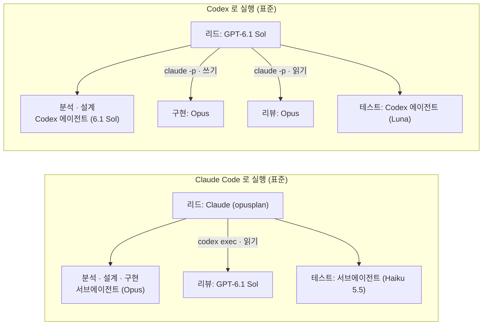
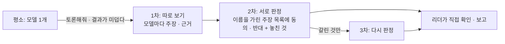

# 팀 에이전트와 모델

에이전트 도구의 서브에이전트 기능으로 **역할 에이전트**를 만든다 (core 일반 역할 7개 + 팩·프로젝트가 더한 역할). 리드(메인 세션)는 합의된 작업 안에서 일을 나눌 때는 **묻지 않고** 역할 에이전트를 불러 나누고, 끝나면 정리한다 (규칙 `core--29-agents` · `team` 스킬). 단계 전환(분석 → 기획 → 설계 → 구축)과 그 단계의 진행 방식은 사용자와 정한 뒤 시작한다 (규칙 `core--10-communication`). 조사처럼 많이 읽는 일을 맡기고 결론만 받아 메인 대화 context 를 아끼므로 더 오래 일할 수 있다.

실행 방식은 세션 시작 때 훅(`team-mode.js`)이 환경으로 정한다 (이어서 시작 · 대화 요약 뒤에도 그 줄을 다시 넣는다). 팀 모드인데 역할 에이전트를 이름 없이 띄우면 서브에이전트로 돌기 때문에 훅이 막는다 (`kedovi team-mode enforce name`, `agents.enforce.teammateName`). 한 요청의 첫 역할 에이전트 때는 실행 방식과 구성표를 알렸는지 훅이 한 줄로 짚는다 (`enforce roster`, `agents.enforce.rosterAnnounce`). 일을 마친 팀원이 대기로 10분 넘게 남으면 리더가 멈출 때 훅(`team-idle.js`)이 한 번 막고 알린다 (`enforce idle`, `agents.enforce.idleTeammates`). 팀원이나 백그라운드 작업이 남은 채 멈출 때 답변에 상태 줄(`지금 도는 것:`)이 없어도 한 번 막는다 (`enforce status`, `agents.enforce.waitStatus`). Claude Code 의 agent teams(팀원 세션)가 가능하면 **팀 모드**, 아니면 **서브에이전트**. `teammateMode` 가 `tmux` 면 tmux 가 설치돼 있어야 하고(세션 밖이면 Claude Code 가 tmux 세션을 만들어 입력창 오른쪽에 이름을 보여 준다. 다른 터미널에서 `tmux attach -t <이름>`), 없으면 사유와 함께 서브에이전트로 간다. 어느 쪽이든 상한·역할 모델은 같고, 리더는 작업 시작 때 어느 방식인지 한 줄로 알린다.

| 역할 | 하는 일 | 권한 | 등급 |
|---|---|---|---|
| 분석 `analyst` | 현행 코드·요구사항·레거시 조사 | 읽기 전용 | high |
| 설계 `architect` | 설계안·변경 계획·영향 범위 | 읽기 전용 | high |
| 설계 문서 `spec-writer` | 합의된 결정을 설계서·기능정의서·대응표로 빠짐없이 옮김 (`check-docs --cover`) | 쓰기(문서) | high |
| 구현 `implementer` | repo 관례대로 최소 변경 + 검사 | 쓰기 | high |
| 테스트 `tester` | 재현·테스트 작성·검증표 | 쓰기 | standard |
| 리뷰 `reviewer` | diff 검토 (정확성·보안·회귀·테스트 누락) | 읽기 전용 | high |
| 문서화 `documenter` | README·사용법·이슈 문서 | 쓰기(문서) | low |

- **많이 부르지 않는다**: 한 요청(사용자 메시지 하나)에 동시 · 모두 상한이 있다 (절약 2 · 5, 표준 4 · 10, 최고 6 · 20, `agents.limits` 로 바꾼다. 이 PC 값은 팀 값보다 낮게만). Claude Code 는 넘으면 훅이 막고 AI 가 이유와 함께 사용자에게 묻는다. Codex 는 `config.toml` 의 동시 상한과 규칙으로 지킨다. 같은 역할은 새로 부르지 않고 앞 에이전트에게 이어서 맡긴다.
- project 팩의 `agents/` 에 같은 이름을 두면 덮어쓰고, 새 이름이면 역할이 추가된다. 역할 머리말에 `grade: high | standard | low` 를 두면 프로필에 그 역할이 없어도 성향에 맞는 모델이 정해진다 (예: 표준의 high = Sonnet high).

> 참고: 역할 정의 원본은 `packs/core/agents/*.md` 하나다. sync 가 Claude Code 용 `.claude/agents/*.md` 와 Codex 용 `.codex/agents/*.toml` 로 만든다.

## 팀 구성: 자동 · 고정

| 모드 | 동작 |
|---|---|
| **자동** (새 워크스페이스 기본) | 리더가 작업마다 필요한 역할 · 등급 · 모델을 골라 구성표를 알리고 바로 시작한다. 웹 검색으로 고른 모델이 있거나 high 가 4개 이상이면 승인을 받는다 |
| **고정** (옛 워크스페이스 기본) | 역할마다 프로필 모델 그대로 |

- **옵션**: 성향(최고 · 표준 · 절약 = 프로필) · 역할별 선호 모델(`kedovi team-mode`). 대화로 "품질 우선" 처럼 말하면 그 세션 동안 따른다.
- **요금제 여유도**: 직접 연결이면 `kedovi ai` 에서 고른 회사마다 요금제를 묻는다 (이 PC 로그인 정보의 값을 미리 골라 둠, 팀 기본값은 `--team`). 리더는 **빠듯**한 회사 모델을 선호 역할과 대신할 수 없는 high 작업에만 쓰고, **넉넉**한 회사에 high 작업을 먼저 주고, **종량**(API 키 · Enterprise · 게이트웨이)은 같은 품질이면 싼 모델을 쓴다. 요금제는 사람마다 이 PC 에 저장되어 다른 사람 구성에 영향을 주지 않는다.

| 여유도 | Claude | ChatGPT |
|---|---|---|
| 빠듯 | Pro · Team 표준 좌석 | Free · Go · Plus · Business |
| 넉넉 | Max 5x · Max 20x · Team 프리미엄 좌석 | Pro · Enterprise · Edu |
| 종량 | Enterprise · API 키 | API 키 |

- **새 모델 · 요금제**: 목록은 킷 카탈로그(`packs/core/models.json` 의 `tools` · `plans`, 출처 · 확인일 필수) 한 곳이다. 킷 repo 의 주 1회 예약 점검(`npm run models:watch`)이 새 모델 · 카탈로그 오래됨 · 요금제 페이지 변경을 팀장 텔레그램으로 알리고, 팀장이 `docs/model-catalog.md` 절차로 반영해 새 버전으로 낸다. 그 전에 팀이 먼저 써야 하면 `workspace.json` 의 `catalog.tools` · `catalog.plans` 에 출처와 함께 덧붙인다 (킷에 들어오면 sync 가 지우라고 알린다). 로그인 정보에 목록에 없는 요금제가 보이면 sync 가 가장 가까운 것을 고르라고 알리고, 그전엔 빠듯으로 본다.
- **모델 메뉴**: sync 가 개인 지침(`CLAUDE.local.md` · `AGENTS.override.md`)의 「팀 구성」 절에 이 PC 가 쓸 수 있는 모델(연결 방식 · 게이트웨이 반영)을 등급과 LiveBench 분야별 점수(코딩 · 에이전트 코딩 · 추론 · 데이터 분석 · 지시 따르기, 출처 포함)와 함께 적는다. 리더는 이 메뉴 안에서 고른다.
- **웹 검색은 필요할 때만**: 메뉴에 없는 모델(게이트웨이 전용 · 새 모델), 카탈로그 확인일 45일 경과, 사용자 요청. 결과는 팀 공용 `handoffs/MODELS.md` 에 날짜 · 출처와 함께 남겨 다음 사람이 다시 찾지 않는다 (설정 잠금이어도 팀원이 커밋할 수 있다).
- 목록에 없는 역할이 필요하면 리더가 지시서에 임시 역할(목적 · 소유 파일 · 금지)을 적어 가장 가까운 역할로 띄운다.

## 모델 프로필

프로필(**최고 · 표준 · 절약**)이 역할마다 모델과 추론 강도를 정한다. 실행 도구(Claude Code · Codex)마다 표가 따로 있다.
"위임" 이 붙은 칸은 상대 회사 모델이 맡는 역할이다 (아래 "Claude · GPT 혼용"). 이 PC 의 연결 방식(쓰는 AI · 구성)에 따라 실제 값이 바뀐다 (아래 "AI 연결 방식").

**Claude Code 로 실행할 때**

<!-- models:claude: node bin/models.js doc 가 packs/core/models.json 으로 쓴다. 손으로 고치지 않는다 -->
| 역할 | 최고 | **표준** (추천 기본) | 절약 |
|---|---|---|---|
| 메인(리드) | Opus 5.5 (xhigh) | `opusplan` (계획 Opus · 실행 Sonnet) | Sonnet 5.5 |
| 분석 | Opus 5.5 (xhigh) | Opus 5.5 (high) | GPT-6.1 Sol (Codex 위임 · high) |
| 설계 | Opus 5.5 (max) | Opus 5.5 (xhigh) | Sonnet 5.5 (high) |
| 설계 문서 | Opus 5.5 (xhigh) | Sonnet 5.5 (high) | Sonnet 5.5 (medium) |
| 구현 | Opus 5.5 (xhigh) | Opus 5.5 (high) | Sonnet 5.5 |
| 리뷰 | GPT-6.1 Sol (Codex 위임 · high) | GPT-6.1 Sol (Codex 위임 · high) | GPT-6.1 Sol (Codex 위임 · medium) |
| 테스트 | GPT-6.1 Sol (Codex 위임 · high) | Haiku 5.5 (xhigh) | Haiku 5.5 (xhigh) |
| 문서화 | Haiku 5.5 | Haiku 5.5 | Haiku 5.5 |
| 교차 검토 → Codex | GPT-6.1 Sol (high) | GPT-6.1 Sol (high) | GPT-6.1 Sol (medium) |
<!-- /models:claude -->

**OpenAI Codex 로 실행할 때**

<!-- models:codex: node bin/models.js doc 가 packs/core/models.json 으로 쓴다. 손으로 고치지 않는다 -->
| 역할 | 최고 | **표준** (추천 기본) | 절약 |
|---|---|---|---|
| 메인(리드) | GPT-6.1 Sol (high) | GPT-6.1 Sol (high) | GPT-6.1 Sol (medium) |
| 분석 | GPT-6.1 Sol (xhigh) | GPT-6.1 Sol (xhigh) | GPT-6.1 Sol (high) |
| 설계 | Opus 5.5 (Claude 위임 · max) | GPT-6.1 Sol (xhigh) | GPT-6.1 Sol (high) |
| 설계 문서 | GPT-6.1 Sol (xhigh) | GPT-6.1 Sol (high) | GPT-6.1 Sol (medium) |
| 구현 | Opus 5.5 (Claude 위임 · xhigh) | Opus 5.5 (Claude 위임 · high) | GPT-6.1 Sol (medium) |
| 리뷰 | Opus 5.5 (Claude 위임 · xhigh) | Opus 5.5 (Claude 위임 · high) | Sonnet 5.5 (Claude 위임 · high) |
| 테스트 | GPT-6.1 Sol (high) | GPT-6 Luna (max) | GPT-6 Luna (max) |
| 문서화 | GPT-6 Luna (high) | GPT-6 Luna (medium) | GPT-6 Luna (medium) |
| 교차 검토 → Claude | Opus 5.5 (xhigh) | Opus 5.5 (high) | Sonnet 5.5 |
<!-- /models:codex -->

괄호 안은 추론 강도(effort)다. 없으면 역할 정의(`packs/core/agents/*.md`)의 값을 쓴다.

## 모델 선택 이유

독립 측정 LiveBench 를 우선하고, 벤더 발표 수치는 보조로 쓴다.

| 판단 | 근거 요약 |
|---|---|
| 설계·구현은 Opus 5.5 | Fable 5.1 과 전체 점수가 같고(83.2 대 83.4) 에이전틱 코딩은 더 높다(71.7 대 66.1). 값은 40% |
| 분석은 Opus 5.5 · GPT-6.1 Sol | 추론·데이터 분석 상위. Sonnet 5.5 · Luna 는 낮아 분석에 쓰지 않는다 |
| Codex 코딩은 GPT-6.1 Sol (high) | Astra 와 거의 같은 점수를 1/5 비용으로. effort 는 high 가 코딩에 가장 좋다 |
| Claude 테스트는 Haiku 5.5 (xhigh) | Luna max 와 점수가 같고(72.1 대 72.0, 에이전틱 코딩 51.4 대 51.2) 문항당 $0.013 으로 더 싸다. 같은 회사라 위임 없이 서브에이전트로 돈다 |
| Codex 테스트는 Luna (max) | effort 를 올리면 점수가 크게 오르고 문항당 $0.02 |
| 리뷰는 상대 회사 모델 | 구현과 다른 엔진이 봐야 독립 검토가 된다 |

## AI 연결 방식

개인은 Claude 나 GPT 하나만 구독하고, 회사는 게이트웨이로 두 회사 모델을 함께 쓴다. 그래서 init · install 에서 먼저 연결 방식을 묻고 거기에 맞춰 역할 모델을 정한다 (`kedovi ai` 로 언제든 바꾼다).

| 연결 | 쓰는 AI | 시작 도구 | 상대 회사 모델 |
|---|---|---|---|
| AI 서비스 직접 | Claude 만 | Claude Code | 쓰지 않음 (GPT 칸은 같은 회사 대체 모델) |
| AI 서비스 직접 | GPT 만 | Codex | 쓰지 않음 |
| AI 서비스 직접 | 둘 다 | Claude Code | `delegate.js` 로 상대 도구에 위임 |
| AI 게이트웨이 | 게이트웨이 모델 목록으로 정함 | Claude Code | **하위 에이전트로 바로** (GPT 를 메인으로도 가능) |

게이트웨이(Bedrock · Vertex · Foundry)는 `haiku` 가 아직 Haiku 4.5 다. 그래서 표준 · 절약의 Claude 테스트 담당은 게이트웨이에서 GPT-6 Luna (max) 로 바뀐다. GPT 가 없는 게이트웨이면 Haiku 4.5 를 추론 강도 없이 쓰고 sync 가 알린다.

| 구성 | 역할 모델 |
|---|---|
| 두 회사 모델 섞기 | 프로필 표 그대로 (두 회사를 쓸 수 있을 때만) |
| 한 회사 모델만 | 메인과 같은 회사 모델로만. 교차 검토는 쓰지 않는다 |
| 단일 모델 | 모든 역할이 메인 모델. 역할 에이전트는 그대로 불러 context 를 아낀다 |

**게이트웨이**: 킷이 이 PC 의 설정(셸 환경변수 · `~/.claude/settings.json` 의 env · `~/.codex/config.toml` 의 `model_provider`)에서 찾고 `GET /v1/models` 로 모델 목록을 받아 보여 준다. 킷 모델 ID 를 게이트웨이 이름(`gpt-6.1-sol` → `codex/gpt-6.1-sol`)으로 바꿔 쓴다.
저장하는 것은 주소 · 키가 든 **환경변수 이름** · 모델 목록뿐이고 키 값은 어디에도 쓰지 않는다. Claude Code 에 게이트웨이 설정이 없으면 `kedovi start` 가 저장한 주소와 키 환경변수로 잇는다. 게이트웨이에 새 모델이 올라오면 `kedovi ai refresh`.

확인한 동작 (2026-09-30, Claude Code 2.1.284 · Codex 0.158, 게이트웨이 1곳): Claude Code 는 게이트웨이로 GPT 를 메인 · 하위 에이전트(읽기 · 수정 · 명령 실행)로 정상 실행하고 추론 강도도 넘긴다. Codex 안에서 Claude 모델은 도구 호출이 끊기거나 오류가 나서 쓰지 않는다 (Codex 의 Claude 역할은 계속 위임).

## 선택 · 변경

| 언제 | 누가 | 무엇을 | 저장 위치 |
|---|---|---|---|
| `kedovi init` | 리더 | 팀 기본 프로필 · 메인(리드) 모델 | `workspace.json` 의 `agents.profile` · `agents.main` (팀 공유) |
| `kedovi install` · `kedovi agent` | 팀원 | 묻지 않는다. 팀 프로필을 따른다 | |
| 요금제가 팀보다 빠듯할 때 | 팀원 | `kedovi models profile` (화면에서 고른다. 인자 `rich\|standard\|lean\|team`, `team` = 되돌리기) → 내 프로필. **팀과 같거나 낮은 것만** | `.agents/local.json` (이 PC 만) |
| 팀원이 더 높은 프로필을 써도 될 때 | 리더 | `kedovi models allow-higher on` | `workspace.json` 의 `agents.allowHigherProfile` |
| Codex 웹 검색을 끌 때 | 리더 | `kedovi start` 는 Codex 에 `--search` 를 기본으로 붙인다 (흔한 방식 확인 · 근거 검색용). 끄려면 `"webSearch": false` | `workspace.json` 의 `agents.webSearch` |
| 언제든 | 누구나 | `kedovi models` → 프로필 바꾸기 · 역할별로 한 번에 고르기 | 범위를 팀 또는 이 PC 로 고른다 |

개인 값은 팀 값을 넘지 않는다. 팀보다 높은 이 PC 프로필은 적용하지 않고(sync 가 경고), 역할 에이전트 상한(동시 · 모두)도 팀 값 이내다.
팀과 다른 값이 적용 중이면 세션 시작 줄과 `kedovi start` 에 보인다: `모델 프로필: 이 PC 절약 (팀 표준 대신) · 되돌리기 kedovi models profile team · 상한 동시 2 · 모두 5 (팀 4 · 10)`.

**역할별로 직접 고르기**: 기준 프로필을 고른 뒤 메인 → 역할 전부 → 교차 검토 순으로 하나씩 고른다.

- "프로필대로" 를 고르면 직접 고른 값을 지운다.
- 프로필과 같은 모델을 고르면 저장하지 않는다 (프로필이 바뀌면 따라가게).
- 역할에는 상대 회사 모델(`… (Codex 위임)`)도 고를 수 있다. 메인은 실행 도구의 모델만.

**모델이 정해지는 순서** (뒤가 이긴다)

1. 프로필
2. 팀이 역할별로 직접 고른 값 (`workspace.json` 의 `agents`)
3. 이 PC 에서 직접 고른 값 (`.agents/local.json` 의 `agents`)

## 알아 두면 좋은 것

| 항목 | 내용 |
|---|---|
| 추론 강도 덮기 | 같은 자리에 `effort`. 두 도구 공통 `"effort": "max"`, 도구별 `{ "claude": "max", "codex": "xhigh" }` |
| 메인 모델 전달 | `kedovi start` 가 `--model`·`--effort`(Claude), `-m`·`-c model_reasoning_effort`(Codex)로 넘긴다. 전역 설정보다 우선 |
| 역할 에이전트 파일 | 사람마다 모델이 다를 수 있어 git 에 올리지 않고 각자 sync 가 만든다 |
| Fable 과금 | Claude Pro·표준 좌석은 첫 요청부터 사용량 크레딧, Max·프리미엄 좌석은 주간 한도 50% 까지 포함 |
| AI 게이트웨이 | 위 "AI 연결 방식". 별칭(`opus` 등)이 게이트웨이 모델로 이어져 있으면(`ANTHROPIC_DEFAULT_*_MODEL`) 별칭 그대로, 아니면 게이트웨이 모델 ID 로 바꿔 쓴다. 아래 「게이트웨이 모델 이름」 |
| 여러 repo 작업 | 리더가 계획과 repo 간 계약(API · 이벤트 필드)을 먼저 정하고, repo 마다 구현 팀원 1~2명을 동시에 띄운다. 리뷰는 관련 변경 묶음 단위, 끝에 리더가 계약 양쪽을 함께 검증한다. 한 repo 안은 백엔드 · 프론트 · 도메인 단위로 나눈다 (team 스킬) |
| 팀원 git 안전장치 | 팀원 · 하위 에이전트 · 위임 세션은 워크스페이스 루트 repo 에 git 쓰기(commit · reset · checkout · clean · stash 등)와 어디서든 push 를 못 한다 (훅 `git-guard`). `cd` 를 따라가며 실제 위치를 보고, `cd` 가 실패하면 루트에서 도는 것으로 본다. `bash x.sh` 로 부른 스크립트 안도 본다. 위치를 알 수 없으면(`$변수`) `git -C repos/<이름>` 으로 쓰게 한다. push 는 리더만 |
| 팀원 승인 질문 | 팀 모드 팀원 창에 권한 승인이 뜨면 팀원은 멈추고 리더 화면에는 보이지 않는다. 훅이 승인 대기를 적어 리더의 다음 요청 · 턴 끝에 알리고(텔레그램을 켰으면 바로 「🔐 팀원 … 승인 대기」), 사용자가 그 창에서 승인하면 풀린다 |
| 미리 허용한 조회 명령 | 승인 없이 쓰는 읽기 전용 명령: `git log · show · diff · status · blame · grep · ls-files · rev-parse`, `ls · cat · head · tail · wc · grep · rg · tree · pwd`, `kedovi docs show · refs · trace` (`.claude/settings.json` 의 `permissions.allow`, sync 가 만든다). 더 넣을 것은 팀이면 `workspace.json` 의 `claude.settings.permissions.allow`, 나만이면 `.claude/settings.local.json` |
| Codex 역할 모델 | Codex(0.158)는 역할 파일(`.codex/agents`)을 하위 에이전트에 적용하지 않는다. 개인 지침(`AGENTS.override.md`)의 역할 모델 표대로 리더가 `spawn_agent` 에 모델 · 추론 강도를 넣는다 |

### 게이트웨이 모델 이름

| 항목 | 내용 |
|---|---|
| 이름 모양 | 게이트웨이마다 다른 모양을 같은 모델로 알아본다: `claude/claude-opus-5-5` · `anthropic/Claude-Opus-5.5` · `us.anthropic.claude-opus-5-5-v1:0` · `claude-opus-5-5@날짜` · `opus-5-5` |
| 1M 창 | 1M 창 모델이면 이름 끝에 `[1m]` 을 붙여 넘긴다. Claude Code 는 모르는 이름을 200k 로 보고 일찍 압축하기 때문이다 (보낼 때는 뗀다) |
| 별칭 연결 | `ANTHROPIC_DEFAULT_*_MODEL` 값 끝에 `[1m]` 이 있어야 한다. 빠지면 `kedovi doctor` 가 알린다 |

## 모델 버전 관리

| 무엇 | 어떻게 |
|---|---|
| 모델 목록·추천 | 킷의 `packs/core/models.json` 한 곳 (목록 버전 · 퇴역 목록 · 모델별 확인일·출처·벤치마크). 킷에서 고쳐 push → 워크스페이스는 `kedovi upgrade` |
| 새 모델 | 킷이 새 모델을 조사해 추천을 바꾸면 킷 새 버전으로 나온다. `kedovi upgrade` 로 받는다 |
| 퇴역 모델 | sync 가 팀·개인 설정의 퇴역·퇴역 예정·목록에 없는 모델을 경고, `kedovi models --migrate` 가 일괄 교체 |
| 킷 새 버전 | `kedovi start` 가 두 가지를 알린다: npm 레지스트리에 이 PC 설치본보다 새 버전이 나왔으면 `npm i -g kedovi` (하루 한 번 확인, 2초 · 실패하면 조용히, 끄기 `KEDOVI_NO_UPDATE_CHECK=1`), 설치본이 워크스페이스보다 새로우면 `kedovi upgrade` |

## Claude · GPT 혼용

각 회사 서비스에 직접 연결하면 두 도구 모두 서브에이전트는 **자기 회사 모델만** 쓸 수 있다. 그래서 상대 회사 모델이 맡는 역할은 **그 도구에게 일을 넘긴다(위임)**. 두 도구가 공식 지원하는 비대화형 실행(`codex exec` · `claude -p`)을 쓴다. AI 게이트웨이를 쓰는 Claude Code 는 위임 없이 하위 에이전트로 바로 쓴다 (위 "AI 연결 방식").

화살표에 명령이 붙은 칸이 상대 회사 도구에게 넘기는(위임) 역할이다.

| 항목 | 내용 |
|---|---|
| 동작 | 위임 역할은 서브에이전트 파일 대신 이 PC 전용 지침(`CLAUDE.local.md` · `AGENTS.override.md`)의 **역할 위임 표**에 오른다. 리더가 `packs/core/bin/delegate.js start` 로 상대 도구를 백그라운드로 실행하고 `wait` 로 결과를 받는다 (아직이면 경과 시간 · 마지막 로그 한 줄). 위임 세션 안에서는 워크스페이스 훅이 돌지 않는다 |
| 권한 | 쓰기 역할은 워크스페이스 안 쓰기, 읽기 역할은 읽기 전용(Claude 는 읽기용 셸 `git diff` · `git show` · `git log` · `grep` 등만 돌린다). 위임받은 쪽은 커밋·push 하지 않는다 |
| 맥락 | 위임받은 쪽은 리더의 대화를 모른다. 리더가 완결된 작업 지시서(목적 · 근거 · 소유 파일 · 검증 명령)를 넘긴다 |
| Codex 가 리더일 때 | 샌드박스가 네트워크를 막아 위임 명령만 **샌드박스 밖 실행을 승인**한다. 메인 세션의 네트워크는 열지 않는다 |
| 필요한 것 | 두 도구 모두 설치·로그인, 비용은 각 구독. 상대 도구가 없는 PC 는 같은 회사 대체 모델로 바뀌고 sync 가 알린다 |
| 사용량 한도(429) | 결과 머리에 「상대 도구로 다시: …」 명령 한 줄이 나온다. 같은 지시서(`task.md`)로 다른 도구에 맡긴다 |

**교차 검토** (`cross-review` 스킬): 변경을 상대 회사 모델에게 읽기 전용으로 검토받아 두 의견을 대조한다. 모델은 `kedovi models` 의 "교차 검토 모델".

## 토론 모드

평소 리뷰는 다른 회사 모델 하나가 본다. 사용자가 "토론해줘" 라고 하거나 결과가 미덥다는 말("마음에 안 들어" · "맞아?" · "다시 봐")을 하면, 에이전트가 토론을 제안하고 확인받은 뒤 여러 모델(2~4개, 다른 회사 모델 포함)이 같은 문제를 본다. 코드 리뷰 · 설계 · 요구 · 문서 · 원인 분석 어떤 작업이든 된다 (`debate` 스킬).

| 항목 | 내용 |
|---|---|
| 패널 고르기 | 이 PC 에서 쓸 수 있는 모델(설치된 CLI · `kedovi ai` 설정 · 로그인 요금제) 중 작업에 맞는 것을 에이전트가 고른다. 다른 회사 모델을 꼭 넣고, 작업 강점(코드 = 코딩 점수, 설계 = 추론, 문서 = 언어)을 보고, 가장 비싼 급은 하나만. 목록: `kedovi debate models --task code` |
| 판정 | 근거(파일:줄 · 확인한 내용) 없는 동의 · 반대는 보류로 센다. 누가 냈는지 가려 자기 주장 편들기를 줄인다 |
| 결과 | 합의 · 갈림(양쪽 근거) · 기각 · 한 모델만. 리더가 발견마다 직접 확인해 판정하고, 갈린 것은 근거를 놓고 정하거나 사용자에게 묻는다 |
| 실패 | 사용량 한도 · 로그인으로 빠진 모델은 다른 모델로 대신하지 않고 「빠진 모델」로 적는다. 2개 미만이면 멈춘다 |
| Codex 가 리더일 때 | 샌드박스가 네트워크를 막아 토론 시작이 멈춘다. 시작 명령만 샌드박스 밖 실행을 승인하면 된다 (기다리기 · 진행 보기는 안에서 된다) |
| 비용 | 모델 수 × 회차라 보통 평소 리뷰의 5~7배. 요청할 때만 돈다. 읽기 전용이다 |
| 보기 | 리더가 회차마다 채팅에 중계한다 (모델별 주장 수 · 합의 · 갈림과 누가 어느 쪽인지). 자세히 보려면 다른 터미널에서 `kedovi debate watch [id]`: 모델이 끝날 때마다 주장 · 판정 · 근거가 붙는다. 목록 `kedovi debate list` · 상태 `kedovi debate status [id]` |

> 근거: 같은 모델끼리의 토론은 비슷한 답으로 다수결이 되고, 다른 회사 모델을 섞을 때 정확도가 오른다 ([arXiv 2502.08788](https://arxiv.org/abs/2502.08788v3) · [2410.12853](https://arxiv.org/abs/2410.12853v1) · [2601.05746](https://arxiv.org/abs/2601.05746)). 진행 방식은 공개 프로젝트를 참고했다: 따로 답한 뒤 이름을 가려 서로 평가(karpathy/llm-council), 모두 동의할 때까지 비판하고 근거 없는 동의를 다시 묻기(spec-debate), 빠진 모델 기록(claude-octopus).
