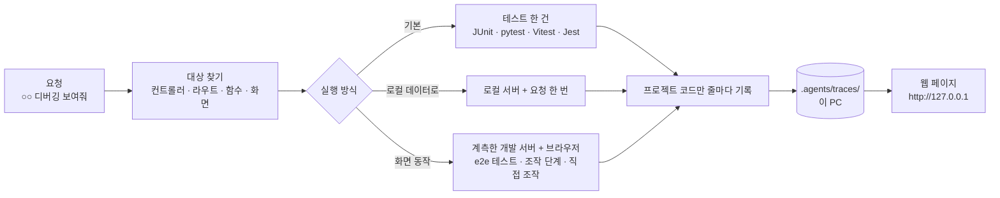
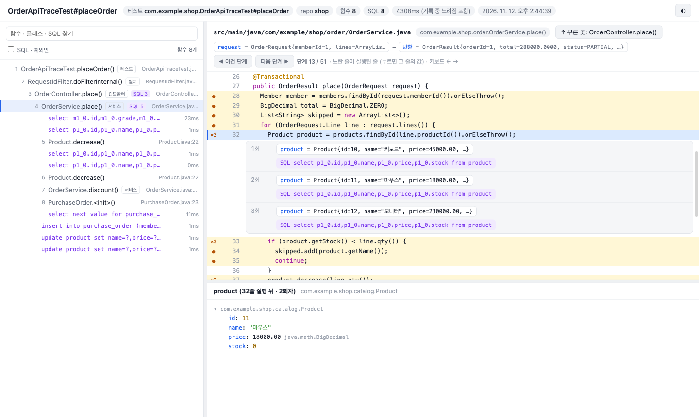
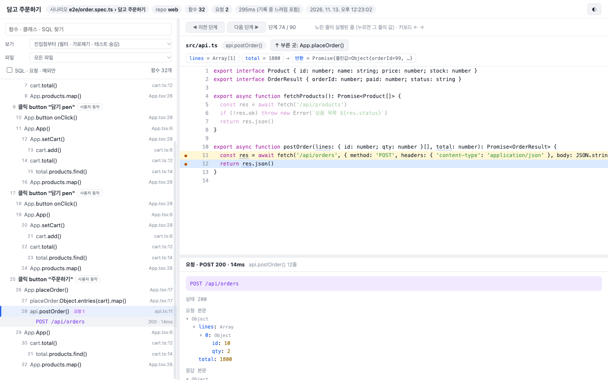
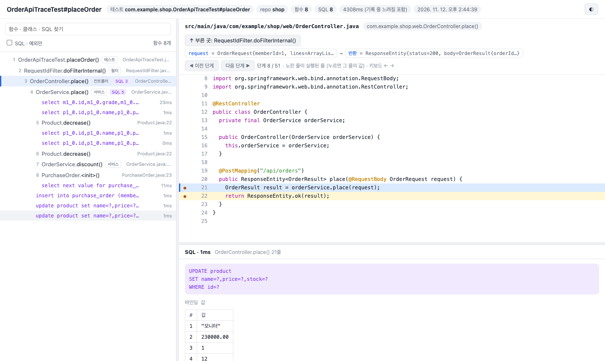

# 실행 흐름 디버깅

API · 함수 · 배치 · 화면 동작 한 번이 어떤 값으로 들어와 어느 함수를 거치고, 줄마다 값이 어떻게 바뀌고, 어떤 SQL · 요청이 나갔는지를 IDE 디버거처럼 웹 페이지로 본다. `trace` 팩을 켜면 쓸 수 있다 (`kedovi upgrade --add trace`).

Java · Kotlin(JVM), Python, JS · TS(React 같은 웹 화면, Node 서버)를 같은 화면으로 본다. 프로젝트 코드는 고치지 않는다.

채팅에서 "주문 API 디버깅 보여줘" · "주문하기 버튼 누르면 어떻게 도는지 보여줘" 라고 하면 에이전트가 `debug-trace` 스킬로 대상을 찾아 기록하고 `자세히: <링크>` 를 준다.

## 채팅 사용법

| 이렇게 말하면 | 에이전트가 하는 것 |
|---|---|
| "주문 API 디버깅 보여줘" · "`POST /api/orders` 실행 흐름 보여줘" | 그 경로를 받는 컨트롤러 · 라우트를 찾아 테스트로 기록 |
| "`OrderService.place` 어떻게 도는지 보여줘" · "정산 배치 흐름 보여줘" | 그 함수 · 배치를 부르는 테스트로 기록 |
| "주문 API 로컬 데이터로 디버깅 보여줘" | 로컬 서버를 띄워 실제 요청 한 번을 기록하고 끈다 |
| "주문 화면에서 취소 누르면 어떻게 도는지 보여줘" | 그 화면의 e2e 테스트가 있으면 그것으로, 없으면 화면 조작 단계를 만들어 브라우저에서 기록 |
| "할인 금액이 어디서 바뀌는지 보여줘" | 그 값이 지나는 흐름을 기록 |
| "지난 디버깅 기록 보여줘" | 최근 기록 목록 |

- 후보가 여럿이면 하나를 묻는다. 부르는 테스트가 없으면 기록용 테스트를 만들고 알린다 (커밋은 묻는다).
- 답은 결론 · 흐름 요약 몇 줄 · `자세히: <링크>`. 링크를 누르면 이 PC 브라우저에서 화면이 열린다.

## 흐름

## 화면

| 자리 | 보이는 것 |
|---|---|
| 위 | 대상(테스트 · 요청 · 시나리오), repo, 함수 · SQL · 요청 · 예외 수, 응답 상태 |
| 왼쪽 | 탄 함수를 실행 순서대로 들여 써서 (진입점 → 서비스 → 저장소 꼬리표). SQL · 요청 · 예외도 그 자리에 끼워 보인다. 웹 화면은 「사용자 동작」(클릭 · 입력 · 제출) 아래에 그 뒤 불린 핸들러 · 렌더 · 요청이 붙는다. 찾기 · 「SQL · 요청 · 예외만」 |
| 왼쪽 위 「보기」 | 기본은 「진입점부터」: 컨트롤러 · 라우트(`@…Mapping` · `@app.post` · `@Post` · `app.post(…)`)나 테스트가 부른 함수, 웹은 사용자 동작부터 보인다. 필터 · 미들웨어 · 가로채기 · 테스트 코드는 숨긴다. 「필터 · 가로채기 포함」 · 「테스트 코드까지 전체」로 넓힌다 |
| 왼쪽 위 「파일」 | 고른 소스 파일의 함수만 보이고, 이전 · 다음 단계도 그 함수 안에서만 움직인다 |
| 오른쪽 위 | 고른 함수의 소스(언어별 색). 인자 · 반환값, 실행된 줄은 노란색(×3 = 세 번 실행). 변수 이름에 마우스를 올리면 그 단계의 값이 나무로 뜬다. 줄을 누르면 회차마다 그 줄 실행 뒤 바뀐 값 · 부른 함수 · SQL · 요청 · 예외가 펼쳐진다. 「이전 · 다음 단계」(← →)로 한 줄씩 |
| 오른쪽 아래 | 데이터 상세: 값의 객체 나무, SQL 문 · 바인딩 값 · 걸린 시간, 요청의 주소 · 상태 · 요청 본문 · 응답 본문, 예외의 던진 곳 · 잡은 곳 |

## 실행 방식

| 언어 | 방식 | 명령 |
|---|---|---|
| Java · Kotlin | 테스트 (기본) | `kedovi trace run --test <테스트 클래스>#<메서드>` |
| | 로컬 서버 요청 | `kedovi trace run --request "POST http://localhost:8080/api/orders" --data '{…}'` (bootRun · spring-boot:run 을 띄우고 끈다) |
| | 이미 띄운 서버 | 위 명령 + `--attach <디버그 포트>` |
| Python | 테스트 (기본) | `kedovi trace run --test tests/test_order.py::test_place` (함수 이름만 줘도 찾는다) |
| | 로컬 서버 요청 | `kedovi trace run --request "POST http://localhost:8000/api/orders" --data '{…}'` (FastAPI · Starlette = uvicorn, Flask, Django 를 찾아 띄운다. 다르면 `--serve "<명령>"`) |
| 웹 화면 (Vite) | 기존 e2e 테스트 (추천) | `kedovi trace run --test e2e/order.spec.ts::<테스트 이름>` (Playwright 테스트를 계측한 개발 서버로 돌린다. API 흉내 · 조작은 테스트 그대로) |
| | 조작 단계 | `kedovi trace run --web "goto /orders; click text=주문하기; wait [role=status]"` |
| | 직접 조작 | `kedovi trace run --web --manual` (브라우저가 뜨고, 다 했으면 터미널에서 Enter) |
| JS · TS 단위 | Vitest · Jest | `kedovi trace run --test src/cart.test.ts::<테스트 이름>` (package.json 의 test 스크립트로 고른다) |
| Node 서버 | 로컬 서버 요청 | `kedovi trace run --request "POST http://localhost:3000/api/orders" --data '{…}' [--serve "npm run start"]` (빌드한 JS · tsx 모두) |

공통 옵션: `--repo <이름>` · `--dir <경로>` · `--sql off` · `--max-steps`(테스트 · 서버 5000, 화면 30000) · `--max-hits 30`(반복 줄마다 값을 남기는 회차) · `--title`. Java 만 `--include 패키지,…`, 웹만 `--project <Playwright 프로젝트>` · `--headed`. 지난 기록은 `kedovi trace list` · `kedovi trace open`.

프런트가 repo 의 하위 폴더(`frontend/` · `web/` · `client/`)에 있으면 그 폴더를 찾아 쓴다. 테스트 경로는 그 폴더 기준이다.

### 조작 단계 문법

`;` 이나 줄바꿈으로 나눈다. 선택자는 Playwright 선택자(`text=주문하기` · `role=button[name="주문"]` · CSS)다.

| 단계 | 뜻 |
|---|---|
| `goto /경로` | 화면 열기 (첫 단계가 아니면 기본 `/` 부터) |
| `click <선택자>` · `hover <선택자>` | 누르기 · 올리기 |
| `fill <선택자> <글>` · `select <선택자> <값>` · `check <선택자>` | 입력 · 고르기 · 체크 |
| `press <키>` · `press <선택자> <키>` | 키 누르기 |
| `wait <ms>` · `wait <선택자>` | 기다리기 |

## 기록 방식

| 언어 | 기록 방식 | 값 읽기 |
|---|---|---|
| Java · Kotlin | 표준 디버거 API(JDI)로 디버그 포트에 붙어 프로젝트 패키지의 줄마다 멈췄다 간다 | 필드만 읽고 메서드는 부르지 않는다. `toString` · JPA 지연 로딩이 실행을 바꾸지 않는다 |
| Python | 3.12 이상은 `sys.monitoring`(라이브러리 코드는 꺼서 비용 없음), 3.11 이하는 `sys.settrace`. pytest 플러그인 · 서버 감싸기로 붙는다 | `__dict__` · 슬롯 · 기본 자료형만 읽는다. 프로퍼티 · `__repr__` 를 부르지 않는다 (SQLAlchemy 지연 로딩 그대로) |
| JS · TS | 원본 소스에 같은 줄 안에서 기록 호출을 끼워 넣는다 (Vite 플러그인 · Jest 변환기 · Node 로더). 줄 번호를 숫자로 박아 TS 변환 · 번들 뒤에도 원본 줄과 맞는다. 빌드한 JS · tsx 는 소스맵으로 원본 TS 줄로 되돌린다 | 자기 속성의 값만 읽는다. 게터 · `toString` 을 부르지 않는다 |

| 항목 | 내용 |
|---|---|
| 코드 수정 | 없음. 기록용 테스트 파일만 새로 생길 수 있다. 감싼 설정(Playwright · Jest)은 임시 폴더에 두었다 지운다 |
| 건너뜀 | 라이브러리 · 프레임워크 코드, 도구가 만든 코드(`generated/` · `@generated`), 한 줄짜리 접근자(Java), 게터 · 세터(JS) |
| 반복 | 같은 줄은 30회까지 값을 남기고 나머지는 횟수만. 웹 화면은 사용자 동작마다 3000단계 · 같은 함수 20번까지 (넘으면 그 동작 안에서만 접고 다음 동작부터 다시) |
| 가림 | 이름에 password · secret · token · apikey · credential · authorization(JS 는 cookie · session 도)이 든 변수 · 필드 · 키의 값은 `***` |
| SQL | Java: datasource-proxy(Gradle 은 기록할 때만 붙인다, Maven 은 pom 에 있어야). Python: sqlite3 · psycopg(3) · SQLAlchemy. Node: node:sqlite · pg · mysql2 |
| 요청 | 웹 화면 · Node: fetch · XHR 의 주소 · 상태 · 요청 본문 · 응답 본문 (2만 자까지) |
| 비동기 | Python · JS 는 await 너머도 같은 호출로 잇는다. 다른 스레드에서 시작한 호출은 가장 최근에 움직인 호출 아래에 붙인다. Java 는 시작한 스레드만 |
| 속도 | Java 는 줄마다 멈춰 수십 배 느리다. Python · JS 는 값 복사가 대부분 (줄당 1µs 안팎). 테스트 한 건 · 요청 한 번 · 화면 시나리오 하나 크기에 맞다 |
| 필요한 것 | Java: JDK 17+. Python: 3.10+ (3.12+ 권장). JS: 프로젝트에 설치된 Vite · Vitest · Jest · Playwright, 소스 파서(프로젝트의 typescript, 없으면 이 PC 에 한 번 받는다). Node 서버: 22.15+ |
| 보관 | `.agents/traces/`(gitignore). 실제 데이터 · 지나간 소스가 들어 있으니 밖으로 보내지 않는다. 운영 · 공유 DB 에 붙은 서버는 기록하지 않는다 (주소는 localhost 만) |

> 근거: 언어마다 공식 문서 · 도구 소스 · 측정 자료를 150곳 넘게 조사했다. 디버거로 한 줄씩 멈추는 방식은 JS 에서 줄당 약 170µs(직접 측정)라 화면 렌더가 많은 앱에 맞지 않아, JS 는 코드에 기록 호출을 끼우는 방식(기록당 수십 ns)을 골랐다. Python 은 PEP 669 `sys.monitoring` 이 라이브러리 구간 비용을 없앤다(debugpy · coverage 가 같은 이유로 옮겨 감). 화면 아이디어는 Replay.io · Pernosco(줄별 실행 횟수 · 회차), birdseye(반복 앞부분만 보관), Python Tutor(언어 공통 기록 형식)에서 가져왔다.
