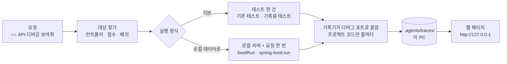

# 실행 흐름 디버깅

API · 함수 · 배치 한 번이 어떤 값으로 들어와 어느 함수를 거치고, 줄마다 값이 어떻게 바뀌고, 어떤 SQL 로 무엇을 조회했는지를 IDE 디버거처럼 웹 페이지로 본다. `trace` 팩을 켜면 쓸 수 있다 (`kedovi upgrade --add trace`).

채팅에서 "주문 API 디버깅 보여줘" · "정산 배치 어떻게 도는지 보여줘" 라고 하면 에이전트가 `debug-trace` 스킬로 대상을 찾아 기록하고 `자세히: <링크>` 를 준다.

## 채팅 사용법

| 이렇게 말하면 | 에이전트가 하는 것 |
|---|---|
| "주문 API 디버깅 보여줘" · "`POST /api/orders` 실행 흐름 보여줘" | 그 경로의 컨트롤러를 찾아 테스트로 기록 |
| "`OrderService.place` 어떻게 도는지 보여줘" | 그 함수를 부르는 테스트로 기록 |
| "정산 배치 흐름 보여줘" | 배치 실행 메서드를 테스트로 기록 |
| "주문 API 로컬 데이터로 디버깅 보여줘" | 로컬 서버를 띄워 실제 요청 한 번을 기록 |
| "할인 금액이 어디서 바뀌는지 보여줘" | 그 값이 지나는 흐름을 기록 |
| "지난 디버깅 기록 보여줘" | 최근 기록 목록 |

- 후보가 여럿이면 하나를 묻는다. 부르는 테스트가 없으면 기록용 테스트(`<대상>TraceTest`)를 만들고 알린다 (커밋은 묻는다).
- 답은 결론 · 흐름 요약 몇 줄 · `자세히: <링크>`. 링크를 누르면 이 PC 브라우저에서 화면이 열린다.

## 흐름

## 화면

| 자리 | 보이는 것 |
|---|---|
| 위 | 대상(테스트 · 요청), repo, 함수 · SQL · 예외 수, 응답 상태 |
| 왼쪽 | 탄 함수를 실행 순서대로 들여 써서 (필터 → 컨트롤러 → 서비스 → 저장소 · 배치 꼬리표, SQL · 예외 수). SQL · 예외도 그 자리에 끼워 보인다. 찾기 · 「SQL · 예외만」 |
| 오른쪽 위 | 고른 함수의 소스. 인자 · 반환값, 실행된 줄은 노란색(×3 = 세 번 실행). 줄을 누르면 회차마다 그 줄을 실행한 뒤 바뀐 값 · 그 줄에서 부른 함수 · SQL · 예외가 펼쳐진다. 「이전 · 다음 단계」(키보드 ← →)로 한 줄씩 따라간다 |
| 오른쪽 아래 | 데이터 상세: 고른 값의 객체 나무, SQL 문 · 바인딩 값 · 걸린 시간 · 바뀐 행 수, 예외의 던진 곳 · 잡은 곳 |

## 실행 방식

| 방식 | 명령 | 쓰는 때 |
|---|---|---|
| 테스트 | `kedovi trace run --test <테스트 클래스>#<메서드>` | 기본. 같은 입력으로 다시 볼 수 있다. 함수 · 배치는 이것 |
| 로컬 서버 | `kedovi trace run --request "POST http://localhost:8080/api/orders" --data '{…}'` | 로컬 DB 데이터로 실제 요청을 볼 때. 서버를 디버그 포트와 함께 띄워 요청 한 번을 기록하고 끈다 |
| 이미 띄운 서버 | 위 명령 + `--attach <디버그 포트>` | 디버그 포트(`-agentlib:jdwp=…`)로 직접 띄운 서버. 끄지 않는다 |

공통 옵션: `--repo <이름>` · `--include 패키지,…`(기본은 소스의 공통 패키지 + 테스트 패키지) · `--sql off` · `--max-steps 5000` · `--max-hits 30`(반복 줄마다 값을 남기는 회차) · `--title`. 지난 기록은 `kedovi trace list` · `kedovi trace open`.

## 기록 방식과 한계

| 항목 | 내용 |
|---|---|
| 지원 | JVM: Java · Kotlin, Gradle · Maven, Spring Boot 2 · 3 · 4 (Spring 이 아닌 JVM 프로그램도 테스트로) |
| 코드 수정 | 없음. 디버그 포트(JDWP)로 붙어 프로젝트 패키지의 줄마다 멈췄다 간다. 기록용 테스트 파일만 새로 생길 수 있다 |
| 값 | 필드만 읽고 메서드는 부르지 않는다. `toString` · JPA 지연 로딩이 실행을 바꾸지 않는다 (아직 읽지 않은 연관은 「지연 로딩」 으로 보인다). 깊이 3 · 목록 20개 · 문자열 500자까지 |
| 가림 | 이름에 password · secret · token · apikey · credential · authorization 이 든 변수 · 필드 · 맵 키의 값은 `***` |
| 건너뜀 | 라이브러리 · 프레임워크 코드, 한 줄짜리 접근자 · 생성자(Lombok · record), 반복 상한을 넘긴 회차의 값(횟수만) |
| SQL | Gradle: 기록할 때만 datasource-proxy 스타터를 붙인다 (초기화 스크립트, 빌드 파일 안 고침). Maven: pom 에 test 범위로 있어야 보인다. 트랜잭션 커밋 때 나가는 insert · update 는 커밋한 줄(서비스를 부른 줄)에 붙는다 |
| 속도 | 줄마다 멈추므로 평소보다 수십 배 느리다. 테스트 한 건 · 요청 한 번 크기에 맞다. 단계 5000개에서 멈춘다 |
| 스레드 | 시작한 스레드만 따라간다. 비동기 · 리액티브(@Async · WebFlux)로 넘어간 흐름은 아직 보이지 않는다 |
| 보관 | `.agents/traces/`(gitignore). 실제 데이터 · 지나간 소스가 들어 있으니 밖으로 보내지 않는다. 운영 · 공유 DB 에 붙은 서버는 기록하지 않는다 (주소는 localhost 만) |

> 근거: 같은 방식(실행 중 값 기록 → 화면에서 줄마다 보기)을 쓰는 도구로 birdseye(Python) · Sidrat · Ulyp(Java)가 있고, 기록기는 Java 표준 디버거 API(JDI)로 만들었다. SQL 수집은 datasource-proxy(Spring Boot 스타터)의 `afterQuery` 를 읽는다.
