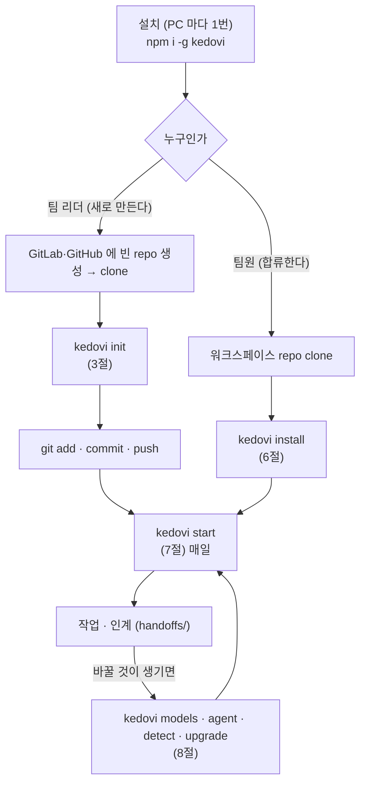
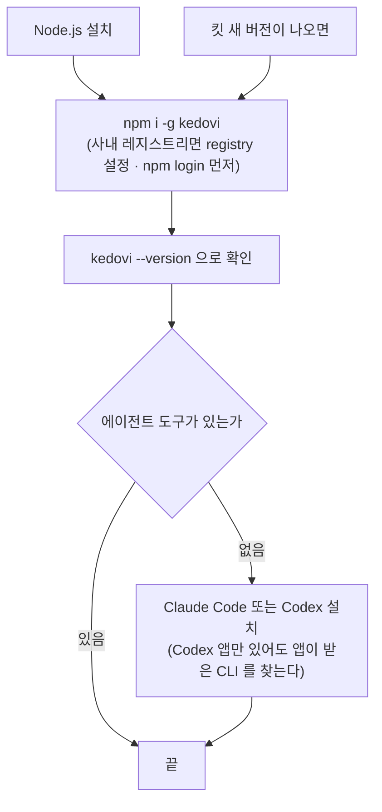
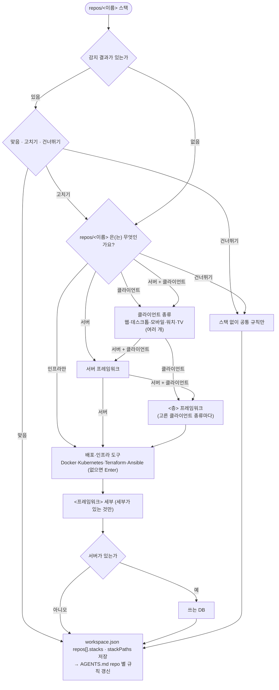
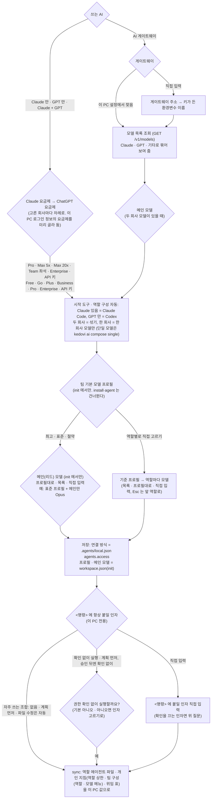
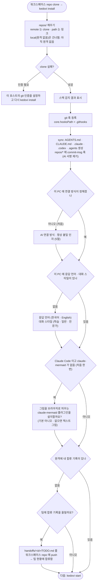
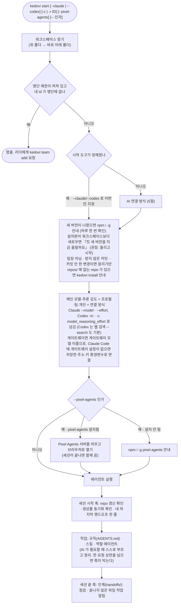
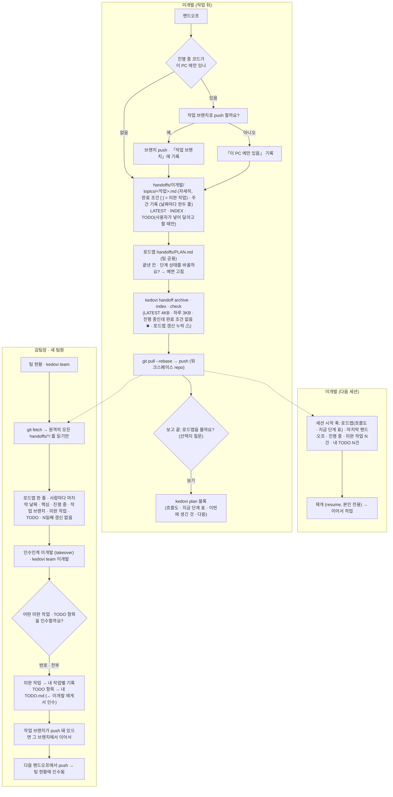

# 업무 흐름

팀 리더(워크스페이스를 만드는 사람)와 팀원(합류하는 사람)이 **무엇을 고르고, 그 선택이 어디에 저장되는지**를 처음부터 끝까지 그린다.
화면의 질문 문구는 실제 선택 화면(`bin/kedovi.js`)과 같다.

> 이 문서는 선택 화면·명령과 한 쌍이다. 질문·선택지·저장 위치를 바꾸면 같은 커밋에서 고친다.
> `npm test` 가 코드의 질문 문구와 명령이 이 문서에 모두 있는지 검사한다.

## 1. 전체 그림

## 2. 설치 (PC 마다 1번)

- 명령과 확인 순서는 [설치](../README.md#설치-pc-마다-1번) 한 곳에 있다. 새 버전은 같은 설치 명령을 다시 실행한다.
- AI 게이트웨이(여러 회사 모델을 한 주소로 주는 서버)를 쓰면 init·install 의 "AI 연결 방식" 에서 고른다. 킷이 이 PC 설정에서 찾아 모델 목록을 조회한다 (5절). 키 값은 저장하지 않는다.
  팀 설정(workspace.json)에서 온 게이트웨이는 https(또는 이 PC 안 주소)여야 하고, `kedovi start` 가 처음 한 번 "팀 설정(workspace.json)의 게이트웨이로 키를 보낼까요?" 를 묻는다 (처음 보는 주소면 아니오). 승인은 이 PC(`.agents/local.json`)에 남는다. 공유 파일 한 줄 수정으로 키가 다른 서버로 가지 않게 하려는 것이다.
  연결 방식을 정하지 않은 워크스페이스는 서비스 직접으로 본다. 이 PC 의 Claude Code 가 게이트웨이로 이어져 있으면 `kedovi ai show` · `kedovi doctor` 가 그 주소를 알리고 `kedovi ai gateway` 로 맞추라고 한다.

## 3. 팀 리더 (`kedovi init`)

빈 repo 를 clone 한 폴더(또는 그 위 폴더)에서 실행한다. **Esc = 이전 질문** (워크스페이스를 만든 뒤의 스택·규칙·에이전트 질문도 같다), 첫 질문에서 Esc 는 취소, Ctrl+C 는 전체 취소.
"이대로 만들까요?" 에서 예를 누르기 전에는 아무것도 만들지 않는다.

```mermaid
flowchart TD
    S(["kedovi init"]) --> N["프로젝트명<br/>영문 소문자와 -"]
    N --> T{"시작 유형<br/>(고르는 유형의 근거 · 넣는 repo · AI 가 하는 일을 아래에 보여 줌)"}
    T -->|"운영·고도화 (SM 포함)"| AP{"진행 방식<br/>이슈형 (운영 · 유지보수) · MVP · 스프린트 (고도화) · 워터폴 · 전체 (고도화)"}
    T -->|"신규 구축"| DV{"개발 방식<br/>MVP · 스프린트 (권장) · 워터폴 · 전체<br/>(둘 다 아이디어 · 전체 그림부터)"}
    T -->|"차세대 전환"| FR
    DV --> FR
    AP --> FR{"분석·설계 워크스페이스에서 이어 만들까요?<br/>(기본 아니오)"}
    FR -->|"예"| FP["분석·설계 워크스페이스 폴더<br/>그 기획 · 이슈 repo 를 가져옴 (원격이 있으면 주소, 없으면 그 로컬 폴더)<br/>현행 repo 는 목록만 (차세대는 레거시로)"]
    FR -->|"아니오"| C1
    FP --> C1["프로젝트 repository 주소<br/>신규 · 차세대: clone · 기존 로컬 폴더 · 새로 만들기 · 없음<br/>운영·고도화: clone · 기존 로컬 폴더, 1개 이상"]
    T -->|"컨설팅"| D["기획 repository 주소<br/>(방식: clone · 기존 로컬 폴더 · 새로 만들기 · 없음)"]
    C1 --> D
    D --> PG{"기획 repo 를 넣었는가"}
    PG -->|"예"| PQ{"기획 문서 사이트를 Pages 로 올릴까요?<br/>(기본 아니오 · 나중에 kedovi docs pages on | off)"}
    PG -->|"아니오"| I
    PQ --> I["이슈 repository 주소<br/>(방식: clone · 기존 로컬 폴더 · 새로 만들기 · 없음)"]
    I --> L{"유형에 레거시가 있는가"}
    L -->|"차세대 전환"| L1["레거시(AS-IS) repository 주소<br/>(방식: clone · 기존 로컬 폴더, 1개 이상)"]
    L -->|"컨설팅"| L2["현행 시스템 repository 주소<br/>(방식: clone · 기존 로컬 폴더 · 없음)"]
    L -->|"그 밖"| H
    L1 --> H
    L2 --> H
    H{"주소만으로 GitHub·GitLab 을<br/>모르는 호스트가 있는가"}
    H -->|"있음"| H1["&lt;호스트&gt; 의 협업 도구<br/>GitLab · GitHub · 기타·없음"]
    H -->|"없음"| OK
    H1 --> OK{"이대로 만들까요?"}
    OK -->|"아니오"| X(["만들지 않고 끝"])
    OK -->|"예"| MK["워크스페이스 생성 · repo clone<br/>스택 자동 감지"]
    MK --> RF{"clone 하지 못한 repo 가 있는가"}
    RF -->|"있음"| RA{"받지 못한 repo n개를 지금 다시 받을까요?<br/>(git clone 그대로, 인증을 물으면 입력 · 아니오면 나중에 kedovi install)"}
    RA --> ST
    RF -->|"없음"| ST["스택 확인 (4절)"]
    ST --> RQ{"킷이 넣은 규칙을 지금 확인할까요?<br/>(기본 아니오)"}
    RQ -->|"예"| RC["켤 규칙 (Space 로 켜고 끄기)<br/>필수 규칙(근거·안전·보안)은 목록에 없음<br/>→ workspace.json rules.off"]
    RQ -->|"아니오"| AG
    RC --> AG["쓰는 AI · 팀 기본 모델 프로필 · 메인(리드) 모델 · 이 PC 의 실행 인자 (5절)"]
    AG --> WR{"워크스페이스 repo 에 원격이 있는가"}
    WR -->|"없음"| WU["워크스페이스 repository 주소<br/>(빈 비공개 repo 주소, 없으면 Enter)"]
    WU --> VP{"공개 repo 인가<br/>(로그인 없이 받아지면 공개)"}
    WR -->|"있음"| VP
    VP -->|"공개"| VQ{"공개 repo 입니다. 그래도 워크스페이스 repo 로 쓸까요?<br/>(기본 아니오: 주소를 다시 묻거나 push 하지 않음)"}
    VQ -->|"예"| PS
    VP -->|"비공개 · 모름"| PS{"지금 커밋·push 할까요?"}
    PS -->|"예"| PD["commit · push → 팀원은 clone 뒤 kedovi install"]
    PS -->|"아니오 · 원격 없음"| RS["repo 상태 표<br/>받지 못한 repo 와 이유 (다시 받기: kedovi install)"]
    PD --> RS
    RS --> END(["공유하기 안내 → 다음: kedovi start"])
```

- repo 마다 방식을 먼저 고르고 값을 넣는다: **clone**(git 주소) · **기존 로컬 폴더**(경로, `repos/<이름>` 에 링크. 원격 없이 로컬에서만 커밋하는 repo 도 됨, `~` 가능) · **새로 만들기**(이름, `repos/<이름>` 에 git init. 레거시 제외) · 없음(선택 항목). 여러 개는 추가·확정으로, Esc 는 방식 선택으로.
- 워크스페이스 repo 는 작업 기록(`handoffs/`) · `workspace.json` 이 올라가므로 비공개로 둔다. init 은 주소를 받으면 로그인 없이 받아지는지(공개인지) 확인해 공개면 한 번 더 묻고, `kedovi doctor` 도 공개면 ⚠ 로 알린다. 워크스페이스 커밋 훅은 올리려는 파일에 비밀값 모양(키 · 토큰 · 개인키)이 있으면 커밋을 막는다.
- 이어 만들기로 가져온 repo 는 목록 안내에 「가져옴 n개」 로 따로 보이고, 가져온 것만 있으면 「확정 (가져온 그대로)」 이 기본이다. 같은 주소 · 이름은 어느 목록에서든 다시 넣지 못한다.
- 킷의 clone 은 인증을 묻지 않게 막고 돈다 (진행 표시 뒤에서 멈추지 않게). 그래서 직접 `git clone` 하면 인증을 물어 받아지는 repo 가 빠질 수 있다. 생성 직후 받지 못한 repo 를 보이고 인증을 물을 수 있는 `git clone` 으로 다시 받을지 묻는다.
- 그래도 빠진 repo 는 끝 화면의 repo 상태 표에 이유와 함께 남는다. 다시 받기는 `kedovi install` (있는 repo 는 건너뛴다. `kedovi sync` 는 받지 않는다).
- 분석·설계 워크스페이스의 산출물 repo 를 개발 워크스페이스에서 참고하려면 「기획 repository 주소」에 그 repo 를 넣는다 (로컬에만 있으면 기존 로컬 폴더).
- 원격 없는 repo 를 로컬 폴더로 넣으면(이어 만들기 포함) 두 워크스페이스가 링크로 같은 파일을 쓴다. 기획 repo 의 커밋 훅과 문서 사이트(`kedovi docs build`)는 원래 워크스페이스 것을 쓰고, 빌려 쓰는 쪽 sync 는 훅을 덮지 않는다. 따로 쓰려면 원격을 만들어 clone 으로 넣는다.
- 유형마다 붙는 규칙과 근거가 다르다: 신규·차세대는 기획 문서, 차세대는 레거시 소스도, 운영·고도화는 운영 중인 코드, 컨설팅은 코드를 고치지 않는다. 이슈·티켓 처리는 모든 유형 공통이다.

## 4. 스택 확인 (init · `kedovi detect`)

코드 repo 마다 한 번씩 묻는다. 감지가 맞으면 한 화면으로 끝난다.

- 프레임워크·인프라 도구·세부·DB 는 여러 개를 고를 수 있고, 없거나 모르면 Enter 로 건너뛴다. 인프라 도구(Dockerfile · 매니페스트 · IaC)는 서버 · 클라이언트 repo 에도 함께 있을 수 있어 건너뛰기가 아니면 묻는다.
- 멀티모듈 repo 는 스택마다 모듈 경로(`api/`, `client/`)가 붙는다.
- 사내 라이브러리를 거쳐 못 잡는 스택은 `kedovi detect --hint <스택> --contains <정규식>`.

## 5. AI 연결 방식과 모델 프로필

연결 방식은 init(팀 리더)과 install·`kedovi agent`(팀원·개인)에서 묻고, 사람마다 다르므로(구독·게이트웨이) **이 PC 에만** 저장한다.
직접 연결이면 고른 회사마다 **요금제**를 묻는다. 요금제는 여유도(빠듯 · 넉넉 · 종량)로 바뀌어 자동 팀 구성에서 리더가 회사별로 모델을 나누는 기준이 된다. 이 PC 로그인 정보(`~/.claude.json` · `~/.codex/auth.json`)의 요금제를 미리 골라 두고, 나중에 로그인 값이 저장한 값과 달라지면 sync 가 알린다. 게이트웨이는 종량으로 본다. 화면 없이: `kedovi ai plan claude|gpt <요금제> [--team]`.
모델 프로필과 메인(리드) 모델은 init 에서만 묻는다(팀 기본값, 메인은 `workspace.json` `agents.main`). 프로필을 고른 뒤 메인만 따로 올릴 수 있다(예: 표준 + 메인 Opus). 팀원의 이 PC 프로필은 `kedovi models profile <이름>` 으로만 두고, 팀과 같거나 낮은 것만 적용된다.

| 구성 | 역할 모델 |
|---|---|
| 두 회사 모델 섞기 | 아래 표 그대로. 리뷰·테스트 등을 다른 회사 모델이 맡는다 |
| 한 회사 모델만 | 다른 회사 칸은 같은 회사 대체 모델(`fallback`)로. 교차 검토는 쓰지 않는다 |
| 단일 모델 | 모든 역할이 메인 모델. 역할 에이전트는 그대로 불러 대화 context 를 아낀다 |

구성은 "쓰는 AI" 에서 자동으로 정해진다 (두 회사 = 섞기, 한 회사 = 한 회사 모델만). 단일 모델은 `kedovi ai compose single`.

다른 회사 모델을 쓰는 방법은 연결 방식에 따라 다르다.

| 연결 | Claude Code 세션의 GPT 역할 | Codex 세션의 Claude 역할 |
|---|---|---|
| AI 서비스 직접 | `delegate.js` 로 Codex 에 위임 | `delegate.js` 로 Claude Code 에 위임 |
| AI 게이트웨이 | **하위 에이전트로 바로** (역할 파일 모델 = 게이트웨이 모델 ID). GPT 를 메인으로도 쓸 수 있다 | 위임 (Codex 안에서 Claude 모델은 도구 호출이 끊겨 쓰지 않는다) |

Codex 는 역할 파일(`.codex/agents`)을 하위 에이전트에 적용하지 않아서(0.158 확인), 개인 지침의 「팀 구성」 표(자동이면 리더가 고른 모델)대로 리더가 `spawn_agent` 에 모델·추론 강도를 넣는다.

팀 구성 모드는 새 워크스페이스가 **자동**(리더가 작업마다 역할 · 등급 · 모델을 골라 구성표를 알리고 시작), `agents.mode` 가 없는 옛 워크스페이스가 **고정**(프로필대로)이다. `kedovi team-mode` 로 바꾼다.

진행 방식은 새 워크스페이스가 유형마다 정해진다 (신규 구축은 init 에서 MVP · 워터폴, 운영·고도화는 이슈형 · 스프린트 · 전체 중 고른다): 신규 · 운영·고도화 = **MVP · 스프린트**(기능 단위 스프린트. 끝까지 동작하는 최소 기능부터 만들고 나머지는 백로그, 스프린트마다 데모 · 회고하며 하나씩 붙임), 차세대 · 분석·설계 = **워터폴 · 전체**(전체 범위를 설계한 뒤 구축). 신규 구축은 두 방식 모두 첫 단계가 「아이디어 · 전체 그림」(무엇을 왜 만드는지 대화 → 기능 지도 → MVP 범위, 건너뛸 수 있음)이다. `project.approach` 가 없는 옛 워크스페이스는 전체처럼 동작하고, `kedovi upgrade` 가 고르는 법을 알린다. `kedovi approach` 로 바꾼다. 이슈마다 운영에 반영하는 운영 · 유지보수는 **이슈형**(단계 대신 이슈 보드)이다.
프로필 선택 화면은 시작 도구와 연결 방식을 반영한 표를 보여 준다.
역할 에이전트 상한(한 요청에 동시 · 모두)은 프로필마다 정해져 있다 (절약 1·3, 표준 2·5, 최고 3·8). `workspace.json`·`.agents/local.json` 의 `agents.limits` 로 바꾼다. 이 PC 값은 팀 값보다 낮게만 적용된다.

**Claude Code 로 실행할 때**

<!-- models:claude: node bin/models.js doc 가 packs/core/models.json 으로 쓴다. 손으로 고치지 않는다 -->
| 역할 | 최고 | **표준** (추천 기본) | 절약 |
|---|---|---|---|
| 메인(리드) | Opus 5.5 (xhigh) | `opusplan` (계획 Opus · 실행 Sonnet) | Sonnet 5.5 |
| 분석 | Opus 5.5 (xhigh) | Opus 5.5 (high) | GPT-6.1 Sol (Codex 위임 · high) |
| 설계 | Opus 5.5 (max) | Opus 5.5 (xhigh) | Sonnet 5.5 (high) |
| 설계 문서 | Opus 5.5 (xhigh) | Sonnet 5.5 (high) | Sonnet 5.5 (medium) |
| 구현 | Opus 5.5 (xhigh) | Opus 5.5 (high) | Sonnet 5.5 |
| 리뷰 | GPT-6.1 Sol (Codex 위임 · high) | GPT-6.1 Sol (Codex 위임 · high) | GPT-6.1 Sol (Codex 위임 · medium) |
| 테스트 | GPT-6.1 Sol (Codex 위임 · high) | Haiku 5.5 (xhigh) | Haiku 5.5 (xhigh) |
| 문서화 | Haiku 5.5 | Haiku 5.5 | Haiku 5.5 |
| 교차 검토 → Codex | GPT-6.1 Sol (high) | GPT-6.1 Sol (high) | GPT-6.1 Sol (medium) |
<!-- /models:claude -->

**OpenAI Codex 로 실행할 때**

<!-- models:codex: node bin/models.js doc 가 packs/core/models.json 으로 쓴다. 손으로 고치지 않는다 -->
| 역할 | 최고 | **표준** (추천 기본) | 절약 |
|---|---|---|---|
| 메인(리드) | GPT-6.1 Sol (high) | GPT-6.1 Sol (high) | GPT-6.1 Sol (medium) |
| 분석 | GPT-6.1 Sol (xhigh) | GPT-6.1 Sol (xhigh) | GPT-6.1 Sol (high) |
| 설계 | Opus 5.5 (Claude 위임 · max) | GPT-6.1 Sol (xhigh) | GPT-6.1 Sol (high) |
| 설계 문서 | GPT-6.1 Sol (xhigh) | GPT-6.1 Sol (high) | GPT-6.1 Sol (medium) |
| 구현 | Opus 5.5 (Claude 위임 · xhigh) | Opus 5.5 (Claude 위임 · high) | GPT-6.1 Sol (medium) |
| 리뷰 | Opus 5.5 (Claude 위임 · xhigh) | Opus 5.5 (Claude 위임 · high) | Sonnet 5.5 (Claude 위임 · high) |
| 테스트 | GPT-6.1 Sol (high) | GPT-6 Luna (max) | GPT-6 Luna (max) |
| 문서화 | GPT-6 Luna (high) | GPT-6 Luna (medium) | GPT-6 Luna (medium) |
| 교차 검토 → Claude | Opus 5.5 (xhigh) | Opus 5.5 (high) | Sonnet 5.5 |
<!-- /models:codex -->

괄호는 추론 강도(effort). 없으면 역할 정의(`packs/core/agents/*.md`)의 값. 메인의 추론 강도는 `kedovi start` 가 넘긴다 (Claude `--effort`, Codex `-c model_reasoning_effort`).

모델이 정해지는 순서: **프로필 → 팀이 역할별로 직접 고른 값 → 이 PC 에서 직접 고른 값.**
이 PC 프로필은 팀과 같거나 낮은 것만 적용한다 (높은 것은 리더가 `kedovi models allow-higher on` 으로 허용). 상한은 팀 값 이내.

> 참고: 모델 목록 원본은 `packs/core/models.json`
팀과 다른 값이 적용 중이면 세션 시작 줄과 `kedovi start` 에 `모델 프로필: 이 PC 절약 (팀 표준 대신) · 되돌리기 kedovi models profile team · 상한 동시 2 · 모두 5 (팀 4 · 10)` 로 보인다.

## 6. 팀원 (`kedovi install`)

## 7. 매일 (`kedovi start`)

시작하면 브리핑이 나온다: 프로젝트 · 로드맵(완료 n/N · 지금 단계 · 다음 한 줄 + 단계 흐름도 + 지금 단계 표) · 참고 자료 상태(기획·레거시·이슈 repo 가 비어 있는지) · 공지(워크스페이스 루트 `NOTICE.md`, 있을 때) · 마지막 핸드오프 · 미완 작업(진행 중 작업의 완료 조건) · 내 TODO(사용자가 등록한 것). 처음이면 시작 안내.
`--no-brief` 나 `.agents/local.json` 의 `brief: false` 로 끈다 (훅도 조용해진다).

> 참고: 본문은 세션 시작 훅(`session-brief.js`)이 컨텍스트로 넘기고 첫 메시지는 "세션 브리핑" 한 줄이라 화면에 전문이 찍히지 않는다.

지난 대화를 이어서 하려면 `kedovi start -c`(마지막 대화) · `kedovi start -r <세션 ID>`(`/exit` 때 나온 ID) · `kedovi start -r`(목록에서 고르기). 브리핑은 넣지 않고 모델 · 텔레그램 채널은 그대로 적용한다. Codex 는 `codex resume --last` · `resume <ID>` 로 바꿔 넘긴다.
`kedovi start --pixel-agents` 는 이 PC 에 설치된 [Pixel Agents](https://github.com/pablodelucca/pixel-agents)(`npm i -g pixel-agents`)를 워크스페이스에서 띄우고 브라우저로 연다. 메인 에이전트 · 팀원 · 서브에이전트가 사무실 캐릭터로 움직인다(Claude Code 만). 세션이 끝나면 서버도 끈다. 설치돼 있지 않으면 알리고 화면 없이 시작한다. 처음 열 때 그 화면이 `~/.claude/settings.json` 에 훅을 넣을지 묻는다.

## 8. 바꿀 때

```mermaid
flowchart TD
    Q{"무엇을 바꾸나"}
    Q -->|"모델"| MO["kedovi models"]
    MO --> MW{"무엇을 바꿀까요?"}
    MW -->|"프로필 바꾸기"| SC1{"적용 범위<br/>내 PC 만 · 팀 기본값"}
    SC1 --> PF["프로필 고르기 → sync<br/>(역할별로 직접 고르기 → 기준 프로필 → 역할마다)"]
    MW -->|"역할별로 한 번에 고르기"| SC3{"적용 범위"}
    SC3 --> TL4["어느 도구의 역할"]
    TL4 --> RL["메인 → 역할 전부 → 교차 검토(상대 도구)<br/>각각 프로필대로 · 목록 · 직접 입력 → sync"]
    MW -->|"역할 에이전트 하나"| TL1["어느 도구의 모델"]
    TL1 --> SC2{"적용 범위"}
    SC2 --> MD["&lt;도구&gt; 모델<br/>(목록 · 메인과 같게 · 직접 입력 → &lt;도구&gt; 모델 ID)"]
    MW -->|"메인 모델 (팀 기본값)"| TL2["어느 도구의 모델 → 모델"]
    MW -->|"교차 검토 모델"| TL3["어느 도구의 모델 → 모델"]
    Q -->|"퇴역 모델 교체"| MG["kedovi models --migrate"]
    Q -->|"팀 구성 방식"| TMO["kedovi team-mode auto · fixed<br/>prefer &lt;역할&gt; &lt;도구:모델&gt;<br/>enforce name off · warn · block (팀 모드에서 이름 없는 역할 에이전트)<br/>enforce roster off · warn (첫 역할 에이전트 때 구성표 알림)<br/>enforce review off · warn · block (commit · push 전 리뷰 확인, 기본 꺼짐)<br/>enforce idle off · warn · block (대기로 오래 남은 팀원 알림)<br/>enforce status off · block (기다리며 멈출 때 상태 줄)<br/>enforce ask off · block (결정 질문을 글로 끝낼 때)<br/>enforce run off · warn · block (오래 일하는 팀원 · 위임, 기본 60분)<br/>enforce check off · warn · block (리뷰 전 검사 줄)<br/>enforce plan off · warn · block (코드 수정 전 착수 전 확인)<br/>--team 은 팀 기본값(팀장) → sync"]
    Q -->|"비밀값 (토큰)"| SEC["kedovi secret set &lt;이름&gt; [--global] (숨김 입력)<br/>list · test &lt;이름&gt; · rm · import · exec -- &lt;명령&gt;<br/>→ OS 저장소 (키체인 · 자격 증명 팀장 · libsecret)"]
    Q -->|"남은 파일 정리"| TDY["kedovi tidy [--new]<br/>이번 작업 새 파일 · 안 쓰는 자료 · 링크 없는 문서 · 백업 이름 (읽기만)<br/>지우기는 tidy 스킬: 표 → 승인 → 지움 → 검증"]
    Q -->|"기존 폴더 가져오기"| IMP["kedovi import &lt;폴더&gt;<br/>분류 · 절대경로 · 비밀값 의심 줄 (읽기만)<br/>옮기기는 import 스킬: 계획 → 승인 → 반영"]
    Q -->|"리뷰 확인"| RVW["kedovi review status · mark · skip --reason &lt;사유&gt;<br/>commit · push 전 리뷰 안 된 줄 수 (훅이 알림 · 막기)<br/>켜기: kedovi team-mode enforce review warn · block --team"]
    Q -->|"파이프라인 보기"| GLP["kedovi gitlab pipeline [--ref 브랜치 · --mr 번호 · --id ID] [--log]<br/>최근 목록 · 단계별 작업 상태 · 실패한 작업의 로그 끝부분 (읽기만)"]
    Q -->|"수동 작업 실행 · 다시 실행"| GLJ["kedovi gitlab pipeline --id ID --play 작업 · --retry 작업 --yes<br/>manual 이 될 때까지 기다린 뒤 실행 · 끝날 때까지 상태<br/>--yes 없으면 확인 문구만 (운영 배포는 사용자 승인 뒤)"]
    Q -->|"배포 연쇄"| GLW["kedovi gitlab create --json → wait --mr 번호 → merge 번호 --yes<br/>→ wait --ref 브랜치 → play --id ID --job 작업 --yes<br/>열린 MR 은 다시 씀 · 지금 커밋의 파이프라인을 기다림<br/>머지 · 취소는 vars.gitlab.agentMerge 가 true 일 때만"]
    Q -->|"화면 비교"| SCC["kedovi screens compare &lt;화면 ID&gt;<br/>프로토타입 ↔ 구현을 같은 폭(PC · 폰)으로 찍어 compare.html<br/>구현 주소 = @spec 줄의 @route 또는 --impl"]
    Q -->|"응답 언어 · 대화 스타일"| PRF["kedovi prefs language ko · en · style learn · normal · expert [--team]<br/>값 team = 이 PC 값 지우기 · mermaid [install] · setup (화면)<br/>→ .agents/local.json (팀은 workspace.json) → sync"]
    Q -->|"답변 시각 표시"| TS["kedovi timestamp on · off · team [--team]<br/>답변 첫 줄에 요청 받은 시각 (기본 켜짐, Claude Code)<br/>→ .agents/local.json (팀은 workspace.json)"]
    Q -->|"진행 방식"| APR["kedovi approach sprint · full · issue (팀장)<br/>스프린트: 최소 기능부터, 스프린트마다 데모 · 회고 · 전체: 전체 설계 뒤 구축 · 이슈형: 단계 대신 이슈 보드<br/>→ sync · 기본 단계 그대로인 로드맵은 새 뼈대 (이슈형은 고친 로드맵 앞에도 이슈 보드)"]
    Q -->|"유형 바꾸기"| TYP["kedovi type &lt;유형&gt; [--approach a] [--code 이름,…] (팀장)<br/>고칠 repo (현행 → 개발 repo) → 진행 방식<br/>→ 유형 팩 교체 · 로드맵 새 뼈대 (지난 로드맵은 아래에 남김) → sync"]
    Q -->|"요금제"| PLN["kedovi ai (화면) · kedovi ai plan claude|gpt &lt;요금제&gt;<br/>--team 은 팀 기본값 → sync"]
    Q -->|"연결 방식 · 인자"| AGT["kedovi agent (5절)"]
    Q -->|"내 프로필 (팀과 같거나 낮게)"| MP["kedovi models profile (화면에서 고름)<br/>인자: rich · standard · lean · team (되돌리기)"]
    Q -->|"팀원의 높은 프로필 허용"| AH["kedovi models allow-higher (팀장)<br/>팀원이 팀보다 높은 프로필을 써도 되나요? · 인자 on · off"]
    Q -->|"AI 연결 방식만"| AIC["kedovi ai (화면) · kedovi ai show<br/>kedovi ai direct claude,gpt · gateway [--url --key-env] · refresh<br/>kedovi ai compose mix · vendor · single · main claude · gpt [--team]"]
    Q -->|"repo 스택"| DT["kedovi detect (4절)"]
    Q -->|"팀 상황 · 인수"| TM["kedovi team [id] [--take 번호] (9절)"]
    Q -->|"팀장 · 담당 repo"| TLD["kedovi team lead add · add --nick --repos · repos · nick<br/>workspace.json team.leads · members[].repos<br/>kedovi team whoami --refresh (이 PC 사용자: .agents/local.json me)<br/>계정을 못 읽으면 묻기: 저장소 계정 username"]
    Q -->|"설정 수정 권한"| LK["kedovi team edit allow · deny<br/>kedovi team admins &lt;id&gt;<br/>deny: 팀장만 workspace.json · 팩 수정, 팀원은 자기 handoffs/ 와 로드맵만 커밋"]
    Q -->|"알림 · 텔레그램"| NS["kedovi notify setup: 무엇을 설정할까요?<br/>알림 수준(전체 · 결과와 결정 · 진행 현황 · 끄기) · 양방향 대화(이 프로젝트 봇 토큰 · 다시 점검 · 끄기 · 제거) · 자리 비움<br/>개인 알림 봇(개인 봇 토큰 · 바꾸기 · 제거) · 팀 방 알림(팀 봇 토큰 · 팀 방 ID · 팀 봇 제거)<br/>고급(결과 알림 기준 · PC 앞이면 생략 · 진행 현황 알림) · 시험 메시지 · 알림 설정을 모두 지울까요?<br/>→ .agents/local.json · ~/.config/kedovi/telegram.env (팀 방은 workspace.json)"]
    Q -->|"이 PC 설정을 처음 상태로"| RST["kedovi reset: 무엇을 초기화할까요?<br/>이 PC 설정 · 텔레그램 채널 · 세션 임시 기록 · 개인 지침 · 텔레그램 토큰<br/>→ 선택한 항목을 초기화할까요? → sync<br/>팀 설정 · repos · 핸드오프는 그대로. 화면 없이: kedovi reset local,channel --yes"]
    Q -->|"팀 명단"| TA["kedovi team add · remove &lt;id&gt; · members<br/>kedovi team restrict on · off (명단 밖 kedovi start 막기)<br/>→ workspace.json team → commit · push"]
    Q -->|"규칙"| RL["kedovi rules (켤 규칙 고르기)<br/>kedovi rules list · off &lt;ID&gt; · on &lt;ID&gt; [--repo &lt;이름&gt;]<br/>kedovi rules ondemand · always &lt;ID&gt; (AGENTS.md 줄이기)"]
    RL --> RL2["끈 규칙은 AGENTS.md 에서 빠짐 → workspace.json commit · push<br/>바꾸기: packs/project/rules 에 replaces: &lt;ID&gt;"]
    Q -->|"repo 빼기"| RRM["kedovi repo remove &lt;이름&gt; [--delete] (팀장)<br/>workspace.json · 리뷰 대상에서 지움 → sync<br/>이름이 남은 문서 알림 · 폴더는 --delete 때만"]
    Q -->|"repo 지침"| RG["kedovi repo guides [&lt;이름&gt; follow · kit · ignore] [--rescan]<br/>workspace.json repos[].guides · guidesMode → sync"]
    Q -->|"repo 추가"| RA["kedovi repo add [주소 · 폴더 · 이름] [--group &lt;그룹&gt;]"]
    RA --> RK{"repo 종류"}
    RK --> RI["repository<br/>방식: clone · 기존 로컬 폴더 · 새로 만들기 (레거시 제외)<br/>→ git 주소 · 폴더 경로 · 이름"]
    RI --> RG["그룹 폴더 (이미 그룹을 쓰는 워크스페이스만)<br/>기존 그룹 · 그룹 없음 · 새 그룹 → 새 그룹 이름<br/>→ repos/&lt;그룹&gt;/&lt;이름&gt;"]
    RG --> RH["이 repo 의 협업 도구<br/>(주소로 GitHub·GitLab 을 모를 때만)"]
    RH --> RX["clone · 링크 · 새로 만들기 → 스택 확인 → sync"]
    Q -->|"repo 를 그룹 폴더로"| RMV["kedovi repo move &lt;이름&gt; --group &lt;그룹&gt; · --no-group (팀장)<br/>폴더 옮김 · workspace.json group · 문서의 옛 경로 → sync"]
    Q -->|"새로 만든 repo 를 원격에 올림"| RP["git -C repos/&lt;이름&gt; remote add origin &lt;주소&gt; → push"]
    RP --> RF["sync 가 workspace.json 에 remote 기록 (local 삭제)<br/>→ workspace.json commit · push → 팀원 git pull · kedovi install"]
    Q -->|"명령 찾기"| HLP["kedovi --help: 자주 쓰는 명령 · 분류 목록<br/>분류를 고르세요 (터미널) → 그 분류의 명령과 설명<br/>kedovi help &lt;번호&gt; · kedovi help --all · kedovi &lt;명령&gt; --help"]
    Q -->|"이 PC 워크스페이스 모두"| UPA["kedovi upgrade --all [--scan &lt;폴더&gt;]<br/>목록 · 건너뛸 것 → 「옛 버전 워크스페이스를 올릴까요」 → 하나씩 upgrade<br/>끝나면 워크스페이스마다 commit · push"]
    Q -->|"킷 새 버전 반영"| UP["kedovi upgrade [--add 팩]<br/>bin·팩 교체 → sync → commit · push<br/>몇 버전 뒤져도 한 번에 · 꺼진 기본 팩 · 진행 방식은 알림만"]
    Q -->|"워크스페이스 지우기"| RM["kedovi remove [이름] [--force]"]
    RM --> RW{"여기가 워크스페이스 루트인가 (이름을 줬으면 목록에서 찾음)"}
    RW -->|"아니오"| RX(["안내: 그 루트에서 kedovi remove 또는 kedovi remove &lt;이름&gt; (kedovi list)"])
    RW -->|"예"| RC{"저장 안 된 작업이 있나"}
    RC -->|"있음"| RS(["멈춤. 커밋·push 하거나 --force"])
    RC -->|"없음"| RN{"이 워크스페이스를 지울까요? (이름을 줬으면 &lt;경로&gt; 를 지울까요?)"}
    RN -->|"예"| RD(["비움 (.git·README·LICENSE 는 남김 · .gitignore 는 킷 줄 제거)"])
    RN -->|"아니오"| RK(["그대로 둠"])
```

| 명령 | 하는 일 |
|---|---|
| `kedovi list` | 이 PC 에서 만들거나 쓴 워크스페이스 목록 |
| `kedovi help [번호\|명령\|--all]` | 명령 도움말: 분류별로 보기 (`kedovi --help` 는 자주 쓰는 명령 · 분류 목록만) |
| `kedovi sync` | 정본(`packs/`·`workspace.json`)으로 생성물을 다시 만든다 |
| `kedovi check` | 생성물이 정본과 같은지 (pre-commit 이 부른다) |
| `kedovi doctor` | 설치·설정 진단 |
| `kedovi notify setup` | 알림 설정 화면: 알림 수준(전체 · 결과와 결정 · 진행 현황 · 끄기) · 양방향 대화 · 자리 비움 · 개인 봇 · 팀 방 · 고급 |
| `kedovi notify my remote done\|quiet\|send` | 리모트 컨트롤로 Claude 앱에 이어진 세션: done = 작업 끝만 텔레그램(기본, 결정은 앱이 알린다) · quiet = 쉼 · send = 모두 |
| `kedovi notify my desk <초>\|off` | PC 앞이면(그 안에 키보드 · 마우스를 만짐, 기본 120초) 요청 결과 · 위임 끝 · 음성 알림을 보내지 않는다. 결정 대기는 보낸다 |
| `kedovi notify my voice on\|off` | 음성 알림: 결정 질문(기본) · 끝남 보고를 읽어 음성 메시지로 (`scope` · `name <목소리>` · `test`). 대화로 "음성 켜줘" 도 된다 |
| `kedovi notify [my\|team …]` | 화면 없이 같은 일: `my level` · `my away` · `my setup` · `my channel on` 은 봇 토큰을 숨김 입력으로 받는다 (봇 바꾸기 `--new`). `my channel on` 은 양방향 대화(기본 꺼짐, 프로젝트마다 전용 봇, `kedovi start` 가 `--channels` 를 붙인다) |
| `kedovi handoff find <작업>` | 핸드오프 기록 찾기 (`check` · `index` · `archive` · `organize` 도) |
| `kedovi team-mode` | 팀 구성: 자동(리더가 작업마다 역할 · 모델) · 고정(프로필대로), `prefer` 역할별 선호 모델. `enforce <대상>` 은 훅으로 지키게 하는 수준(off · warn · block)이고, 대상(name · roster · idle · status · ask · run · check · plan · review)과 기본값은 [명령](commands.md). `--team` 은 팀 기본값 |
| `kedovi ai plan claude\|gpt <요금제>` | 회사별 요금제 (빠듯 · 넉넉 · 종량). 보통은 `kedovi ai` 화면에서 |
| `kedovi secret` | 비밀값(토큰): `set <이름> [--global]`(숨김 입력) · `list` · `test <이름>`(권한 · 만료) · `rm` · `import`(옛 telegram.env · gitlab-token · 환경변수에서) · `exec -- <명령>`(그 명령에만 주입). OS 저장소에 프로젝트별 · 전역으로, 값은 출력하지 않는다 |
| `kedovi prefs` | 응답 언어(한국어 · English) · 대화 스타일(학습 · 일반 · 전문가) · 그림 미리보기(claude-mermaid). `language` · `style` 이 PC · 값 `team` 이 PC 값 지우기 · `--team` 팀 기본값(팀장) · `mermaid install` · `setup` 화면. 인자 없이 = 지금 값 |
| `kedovi timestamp` | 답변 첫 줄 시각 표시 (Claude Code, 기본 켜짐): 요청 받은 시각 yyyy-MM-dd HH:mm:ss. `on\|off` 이 PC · `team` 이 PC 값 지우기 · `--team` 팀 기본값(팀장). 인자 없이 = 지금 값 |
| `kedovi approach` | 진행 방식: MVP · 스프린트(최소 기능부터 기능 단위로 하나씩) · 워터폴 · 전체(전체 설계 뒤 구축) · 이슈형(운영 · 유지보수: 이슈마다 운영 반영, 이슈 보드). 인자 없이 = 지금 값 (팀장) |
| `kedovi type` | 유형 바꾸기 (분석·설계 → 구축 · 고도화 등): 현행 repo 중 고칠 것을 개발 repo 로 · 진행 방식 · 유형 팩 교체 · 로드맵 새 뼈대. 인자 없이 = 지금 값 (팀장) |
| `kedovi plan` | 로드맵(`handoffs/PLAN.md`): 단계 흐름 · 지금 단계 표 · 이번에 생긴 것 · 다음. 이슈형은 이슈 보드(상태별 건수 · 진행 중 이슈 · 멈춘 이슈 ⚠) (`--short` · `--json` · `--report` 기간 보고 · `init` · `check` 도) |
| `kedovi docs build [repo]` | 기획 repo 의 md · 화면설계서 장 → 같은 경로 구조의 `docs-site/` (정의 ID 앵커 · 근거 색인 · 정의서 폴더마다 ERD). 묶음 · 포함 범위는 `docs-site.json`, 옛 `html/` 은 처음 build 때 옮긴다. `check` 는 md 와 어긋났는지. 둘 다 문서 점검 경고와 mermaid 문법 오류를 낸다. 자세히는 [문서 사이트](docs-site.md) |
| `kedovi docs show <ID>` · `refs <ID>` | 기획 문서를 ID 단위로: 정의 부분만 출력 · 그 ID 가 나오는 곳(기획 · 코드 · 이슈 repo, 파일:줄, ★ 정의 · [동결]) |
| `kedovi delegate watch [id]` · `status [id]` · `list` | 다른 도구에 맡긴 작업(위임)의 진행: 상대 에이전트가 읽고 실행하는 것을 줄마다 · 지금 현황 한 번 · 목록 |
| `kedovi debate list` · `watch [id]` · `status [id]` · `models` | 토론 모드: 목록 · 실시간 보기(모델별 주장 · 판정) · 지금 회차와 모델별 상태 · 쓸 수 있는 모델과 패널 예시 (시작은 채팅에서 "토론해줘") |
| `kedovi docs serve [repo]` | `docs-site/` 를 이 PC 에서 웹 주소(`http://127.0.0.1:8000/`)로 보기. 전체 인쇄와 새로고침 없는 이동까지 된다 |
| `kedovi docs pages [on\|off] [repo]` | 문서 사이트를 Pages 로 올리기 켜고 끄기 · 상태. on = 원격(GitLab · GitHub)에 맞는 CI 파일(`.gitlab-ci.yml` · `.github/workflows/pages.yml`)을 두고 `docs-site/` 를 커밋 대상으로(원격이 없으면 둘 다), off = `.gitignore` 에 `/docs-site/` (CI 는 두어도 돌지 않는다) |
| `kedovi docs refs-quote <파일…>` | 본문 괄호 속 근거(파일:줄)를 그 문단 · 목록 · 표 아래 「> 근거:」 인용구로 옮긴다 (`--dry` = 수만) |
| `kedovi docs trace` | 기획 ID(`vars.docs.traceIds`)와 코드의 `@spec` 주석 대조: 코드에 표시 없는 ID(⚠) · 테스트에 없는 수용 기준(⚠) · 기획에 정의 없는 ID(✖). `--md` 추적표 · `--new` 새 진입 파일 중 ID 없는 것 |
| `kedovi repo add … --group <그룹>` · `kedovi repo move <이름> --group <그룹>` | 그룹 폴더 `repos/<그룹>/<이름>`: 더할 때 그룹을 주거나(이미 그룹을 쓰면 화면에서 고름) 있는 repo 를 옮긴다(폴더 · `workspace.json` · 문서의 옛 경로, `--no-group` 은 빼기) (팀장) |
| `kedovi repo remove <이름>` | repo 빼기: `workspace.json` · 리뷰 대상에서 지우고 sync, 이름이 남은 문서를 알린다. 폴더는 `--delete` 일 때만 (커밋 안 한 변경 · push 안 한 커밋이 있으면 거부) (팀장) |
| `kedovi tidy` | 정리 후보 찾기 (읽기만): 이번 작업 새 파일 · 안 쓰는 자료 · 링크 없는 문서 · 백업 이름. 지우기는 `tidy` 스킬 (표 → 승인 → 지움 → 검증) |
| `kedovi import` | 기존 AI 작업 폴더 훑기 (읽기만): 종류별 분류 · 큰 폴더 · 문서 속 절대경로 · 비밀값 의심 줄. 옮기기는 `import` 스킬 (계획 → 승인 → 반영) |
| `kedovi review` | 리뷰 확인 (기본 꺼짐, `kedovi team-mode enforce review warn\|block --team` 으로 켠다): `status` 대상 repo 마다 리뷰 안 된 줄 수 · `mark` 지금 상태를 리뷰했다고 기록 · `skip --reason` 사용자 승인 뒤 한 번 생략 |
| `kedovi gitlab pipeline` | GitLab 파이프라인 조회 (gitlab 팩): 최근 목록 · 단계별 작업 상태 · `--ref` · `--mr` · `--id` · `--log`(실패한 작업의 로그 끝부분). `--id <ID> --play <작업>` · `--retry <작업>` 은 수동 작업 실행 · 다시 실행 (manual 이 될 때까지 기다리고 끝날 때까지 상태, `--yes` 없으면 확인 문구만) |
| `kedovi gitlab wait` · `merge` · `create` · `play` · `retry` · `cancel` | 배포 연쇄 (gitlab 팩): 지금 커밋의 파이프라인이 끝날 때까지 대기 · 머지할 수 있는지 확인 뒤 머지(머지 커밋 SHA) · 열린 MR 다시 쓰기 · 수동 작업 실행 · 실패한 작업 다시 실행 · 겹친 파이프라인 취소. 머지 · 취소는 `vars.gitlab.agentMerge` 가 true 일 때만, 모두 `--yes` 없으면 확인 문구만 |
| `kedovi board` | 워크스페이스 현황판: 로드맵 · 팀원별 마지막 핸드오프 · 미완 작업 · 공지 + 기록(핸드오프 · 로드맵 · 모델 조사 · 설정 요약). 이 PC 의 `.agents/board/` 에 만들어 브라우저로 연다 (보기 전용) |
| `kedovi screens compare <화면 ID>` | 프로토타입과 구현 화면을 같은 폭(PC 1280 · 폰 390)으로 찍어 나란히 보는 `compare.html` (screens 팩, Playwright). 프로토타입 = 화면 목록의 「프로토타입」 칸 · `prototype/` 파일 이름, 구현 = `@spec` 줄의 `@route` · `--impl` |
| `kedovi screens check [repo]` | 화면설계서 검사 (screens 팩): 근거 ID 가 색인에 있는지 · 화면 ID 중복 · 기능 ID 누락(「화면 없음」 행은 뺀다) · 화면 목록과 장 대조 (이어지는 장 `data-continues` 는 뺀다) |
| `kedovi datamodel check [repo]` | 데이터 설계 검사 (datamodel 팩): 참조 대상 · 기본키 · 중복 · 표 형식(✖), 논리명 · 컨벤션(`vars.datamodel`) · 기능 ID 대조 · 논리 참조 대상 · 고정 스키마 기본키(⚠). ERD 는 `kedovi docs build` 가 정의서 폴더마다 `erd.html` 로 만든다 |
| `kedovi packs` | 팩 목록 |
| `kedovi init-docs [폴더]` | 기획자 repo 뼈대: 개요 · 아이디어 · 규모 → 시스템 구성(아키텍처) → 기능(요구 목록 · 기능 문서) → 화면(목록 · 정책 · 프로토타입) → 데이터 · API → 결정 · 미결 (메뉴 `docs-site.json` · 장 양식 · Pages CI 포함) |

## 9. 인수인계

handoff(기록) · resume(내 작업 재개) · takeover(남의 작업 인수) · 팀 현황.

- 팀원은 `kedovi install` 때 합류 기록(`handoffs/<id>/TODO.md`)을 올려 바로 팀 현황에 보인다. 리더는 `kedovi init` 때 만들어져 첫 커밋에 함께 올라간다.
- 리더가 명단(`kedovi team add`)을 두면 팀 현황에 "미합류"(명단에만 있음)와 "명단에 없음"(합류했지만 명단 밖)도 보인다.
- 각자 자기 폴더(`handoffs/<id>/`)만 쓴다. 예외는 팀 공용 로드맵 `handoffs/PLAN.md` 하나로, 단계 상태를 바꾼 사람이 고친다 (설정 잠금이어도 팀원이 커밋할 수 있다).
- 로드맵은 `kedovi init` 이 유형 · 진행 방식 · 스택마다 기본 단계로 만든다. 전체 방식은 DB 가 있으면 데이터 설계, 화면이 있으면 화면설계를 구현 앞에 넣고, 스프린트 방식은 「스프린트 계획 → 구현 → 데모 → 회고」 를 반복하며 `## 이번 스프린트`(목표 · 끝 날짜(선택) · 기능 = 구현 단계의 하위 작업) · `## 백로그` · `## 지난 스프린트` 를 둔다. 끝 날짜가 지났는데 데모 전이면 `kedovi plan check` 가 ⚠ 로 알린다. `kedovi upgrade` 는 없을 때 만들고, 기본 단계 그대로면 스택 단계를 더한다. 사람이 고친 로드맵에 그 단계가 없으면 `kedovi plan` 이 ⚠ 로 알린다. 단계·영역을 끝낸 보고에는 `kedovi plan` 블록(흐름도 · 지금 단계 표 · 이번에 생긴 것 · 다음)이 붙고, PLAN.md 가 바뀐 push 는 팀 방에 알린다.
- 본인 작업 재개는 `resume`, 다른 사람 작업 이어받기는 `takeover`(인수인계)로 나눈다.
- 인수해도 원래 사람 폴더는 그대로다. 팀 현황이 다른 사람 TODO 의 인수 표시를 보고 "인수됨" 으로 센다.

## 10. 저장 위치

| 파일 | 누가 쓰나 | 공유 | 들어가는 것 |
|---|---|---|---|
| `workspace.json` | init · detect · models(팀) · team-mode(팀) · team add · rules · upgrade | git 공유 | 유형 · repo · 스택 · 팀 모델 프로필 · 팀 구성(`agents.mode` · `save` · `prefer`) · 훅 강제 수준 · 리뷰 확인 대상 · 대기 팀원 시간(`agents.enforce`) · 팀원의 높은 프로필 허용(`agents.allowHigherProfile`) · 팀 직접 지정 모델 · 팀 명단 · 팀장 · 설정 수정 권한(`team`) · 끈 규칙(`rules.off`) · 필요할 때만 읽는 규칙(`rules.onDemand`) |
| `.agents/local.json` | install · agent · ai · models(내 PC) | 이 PC 만 | 시작 도구 · 인자 · AI 연결 방식(`agents.access`: 게이트웨이 주소·키 환경변수 이름·모델 목록, 키 값은 없음) · 내 프로필(팀과 같거나 낮은 것만) · 내가 직접 고른 모델 · 역할 상한(`agents.limits`, 팀 값 이내) |
| `.claude/agents` · `.codex/agents` | sync | 이 PC 만 (사람마다 모델이 달라서) | 역할 에이전트 파일 |
| `CLAUDE.local.md` · `AGENTS.override.md` · `.claude/settings.local.json` | sync | 이 PC 만 | 개인 지침 · 역할 위임 표 · 설정 잠금 지침과 편집 금지(팀원) |
| `AGENTS.md` · `CLAUDE.md` · `.claude/settings.json` · `.codex/config.toml` | sync | git 공유 | 규칙 · 스킬 · 훅 · 팀 메인 모델 |
| `handoffs/<id>/` | handoff · 인수(resume <id> · kedovi team --take) | git 공유 (워크스페이스 repo) | 본인 작업별 기록(미완 작업의 정본) · LATEST · 주간 기록 · TODO(사용자가 등록한 것). 각자 자기 폴더만 |
| `handoffs/PLAN.md` | init · upgrade(없을 때 · 기본 단계 그대로일 때 스택 단계 더함) · handoff(묻고 상태 갱신) | git 공유 (워크스페이스 repo) | 로드맵: 단계 · 상태 · 시작·완료 날짜 · 단계별 하위 작업 · 분모 변경 · 지난 릴리스 |
| `handoffs/MODELS.md` | team 스킬(웹 검색으로 모델을 조사했을 때) | git 공유 (워크스페이스 repo) | 모델 조사: 모델 · 회사 · 확인일 · 작업 유형별 강점 · 출처 |
| `.agents/board/` | `kedovi board` | 이 PC 만 (gitignore) | 현황판 HTML (매번 다시 만든다) |
| `repos/<기획 repo>/docs-site.json` | 사람 · `kedovi docs build`(원본 주소를 처음 한 번) | git 공유 (기획 repo) | 문서 사이트 메뉴 묶음 · 사이트 이름 · 버전 · 원본 보기 주소 · 포함 범위 |
| `repos/<기획 repo>/docs-site/` | `kedovi docs build` | Pages 켜짐: git 공유 (기획 repo) · 꺼짐: 이 PC 만 (.gitignore) | 문서 사이트 · 근거 색인(`assets/ids.json`) · 뷰어 파일. 커밋하는 repo 는 md 와 어긋나면 pre-commit 이 막는다 |
| `repos/<기획 repo>/.gitlab-ci.yml` · `.github/workflows/pages.yml` | `kedovi init-docs` · `kedovi docs pages on` | git 공유 (기획 repo) | Pages 로 올리는 CI. `docs-site/` 를 커밋했을 때만 돈다 |
| `repos/<이름>/` · `repos/<그룹>/<이름>/` | install · repo add | 각자 clone (워크스페이스 git 제외) | 개발 repo. 이력은 원래 repo 로 push. 그룹은 `repos[].group` |
| `~/.kedovi/workspaces.json` | init · 킷 명령 | 이 PC 만 | 워크스페이스 목록 (`kedovi list`) |
