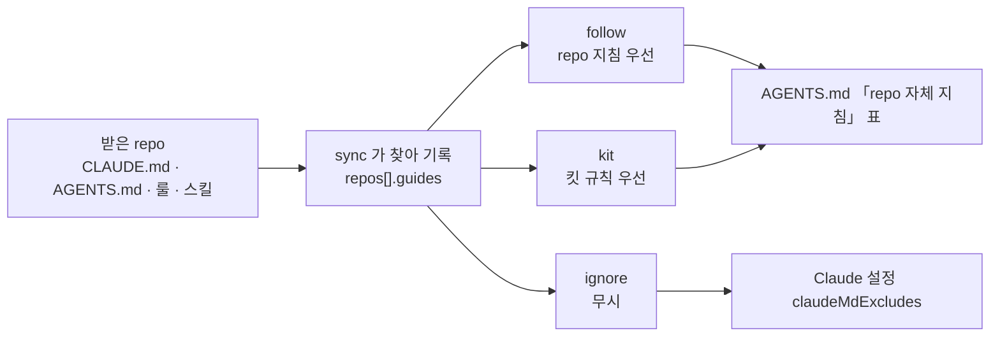

# workspace.json · 설정

## 워크스페이스 구조

```tree
~/project/새프로젝트/          ← 워크스페이스 = kedovi start 하는 곳
├── workspace.json            프로젝트·repo·팩·변수        ← 정본
├── packs/<팩>/                룰·스킬·훅·도구              ← 정본 (project 팩 = 이 프로젝트 전용)
├── AGENTS.md · CLAUDE.md      두 도구가 읽는 지침          (생성)
├── .agents/ .claude/ .codex/  스킬·훅·설정                 (생성)
├── .agents/local.md · local.json   개인 지침 · 시작 도구 · AI 연결 방식 (git 제외)
├── handoffs/{id}/             개발자별 인계
├── handoffs/PLAN.md           로드맵 (팀 공용, kedovi plan)
└── repos/                     (git 제외, install 이 clone)
    ├── backend/ web/ …        kind: code    에이전트가 고친다
    ├── plan/                  kind: docs    요구사항 근거, 읽기 전용
    ├── legacy/                kind: legacy  AS-IS 근거, 읽기 전용 (차세대)
    └── server/order-api/      group: server  그룹 폴더 (repo 가 많을 때, 선택)
```

| 정본 | Claude Code | Codex |
|---|---|---|
| always 룰 + repo 표 + 참고 자료 + 색인 | `CLAUDE.md` → `@AGENTS.md` | `AGENTS.md` |
| on-demand 룰 | `.agents/rules/*.md` | 같음 |
| `packs/*/skills/` | `.claude/skills/` (`/이름`) | `.agents/skills/` (`$이름`) |
| `packs/*/hooks.json` | `.claude/settings.json` | `.codex/hooks.json` |
| `workspace.json` mcp | `.mcp.json` | `.codex/config.toml` |
| `.agents/local.md` | `CLAUDE.local.md` | `AGENTS.override.md` |

**생성 파일은 직접 고치지 않는다.** `packs/` 나 `workspace.json` 을 고치고 `kedovi sync`. 고친 채 커밋하면 pre-commit 이 막는다.


## `workspace.json`

프로젝트 유형과 repo 목록을 정한다.

```json
"project": { "name": "order", "title": "주문 재구축", "type": "modernization" },
"repos": [
  { "name": "backend", "kind": "code",   "remote": "https://…/backend.git", "stack": "Spring Boot 3", "role": "API" },
  { "name": "plan",    "kind": "docs",   "remote": "https://…/plan.git",    "mdPath": "md" },
  { "name": "legacy",  "kind": "legacy", "remote": "https://…/legacy.git",  "sourceRoot": "src" }
]
```

| 항목 | 값 | 효과 |
|---|---|---|
| `project.type` | `new` · `modernization` · `enhancement` · `consulting` | 유형 팩이 없으면 sync 가 멈춘다. 차세대는 `legacy` repo 도 필수, 운영·고도화는 `code` 가 없으면 경고. 옛 `maintenance` 는 `kedovi upgrade` 가 `enhancement` 로 옮긴다 |
| `repos[].kind` | `code` · `docs` · `issues` · `legacy` | code = 에이전트가 고치는 프로젝트 repo, docs = 읽기 전용 기획 문서, issues = 이슈·확인 요청·테스트 문서를 쓰는 곳, legacy = 읽기 전용 AS-IS 소스 |
| `repos[].host` | `github` · `gitlab` · `none`, 자동 | 협업 도구. 주소(또는 로컬 폴더의 origin)로 판단해 저장한다. repo 마다 PR·MR 규칙이 여기서 정해진다 |
| `repos[].remote` / `path` / `local` | git 주소 / 이미 있는 폴더 / `true` | remote 는 clone(권장), path 는 `repos/<이름>` 에 링크, local 은 원격 없이 워크스페이스에서 새로 만든 repo (아래) |
| `repos[].branch` | 선택 | clone 할 브랜치 |
| `repos[].group` | 선택, 영문·숫자·._- | 그룹 폴더. 있으면 `repos/<그룹>/<이름>`, 없으면 `repos/<이름>`. 한 단계만, 이름은 그룹이 달라도 하나만. 아래 「repo 그룹 폴더」 |
| `repos[].stacks` | code, 자동 | 감지된 기술 스택 (`["spring","postgres"]`). repo 별 규칙이 여기서 정해진다. `kedovi detect` 로 다시 감지 |
| `repos[].stackPaths` | code, 자동 | 멀티모듈 repo 에서 스택이 쓰이는 하위 모듈 (`{"spring":["api"],"react":["client"]}`). 감지가 채우고, 한 모듈짜리 repo 에는 없다 |
| `repos[].guides` · `guidesMode` | code · issues, 자동 · 선택 | repo 안에 원래 있던 AI 지침 목록과 따르는 방식. 아래 「repo 자체 지침」 |
| `stackHints` | 선택 | 프로젝트 전용 감지 조건 `[{ "stack": "spring", "contains": "<사내 스타터 좌표 정규식>", "files": [선택] }]`. `kedovi detect --hint` 로 추가 |
| `repos[].mdPath` | docs, 선택 | Word·Excel 원본의 md 사본 폴더 (기획 repo 템플릿은 `md`) |
| `team.leads` · `team.lock` | 선택 | 팀장 `[{ "username", "nickname" }]` (모든 repo · 설정을 고친다) · 팀원 설정 수정 불가(`kedovi team edit deny`). 옛 `team.admins`(username 문자열)도 팀장으로 읽는다 |
| `team.members` · `team.restrict` | 선택 | 팀원 `[{ "username", "nickname", "repos": [repo 이름…] }]` (옛 문자열 목록도 된다) · 명단 밖 사람의 `kedovi start` 막기. 아래 「팀장 · 팀원 · 담당 repo」 |
| `repos[].sourceRoot` | legacy, 선택 | 레거시 소스 하위 경로. modernization 도구의 소스 루트가 여기서 정해진다 |

### repo 그룹 폴더

repo 가 많으면(MSA · 화면 repo 여럿) `repos/` 아래를 그룹으로 나눈다. 그룹은 보기 위한 폴더일 뿐이고, 에이전트 권한은 `kind` 가 정한다.

```json
"repos": [
  { "name": "plans",     "kind": "docs", "group": "plans",  "remote": "…" },
  { "name": "order-api", "kind": "code", "group": "server", "remote": "…" },
  { "name": "admin-web", "kind": "code", "group": "client", "remote": "…" }
]
```

| 할 일 | 명령 |
|---|---|
| 그룹에 더하기 | `kedovi repo add <주소> --group server` (이미 그룹을 쓰면 화면에서 고른다) |
| 있는 repo 옮기기 | `kedovi repo move order-api --group server`: 폴더를 옮기고 `workspace.json` 과 사람이 쓴 md 의 옛 경로를 고친 뒤 sync. `--no-group` 은 `repos/<이름>` 으로 되돌린다 |
| 팀원 PC | `workspace.json` 을 받은 뒤 같은 `kedovi repo move` 를 하거나, 옛 폴더를 지우고 `kedovi install`. `kedovi doctor` 가 「그룹 폴더와 실제 위치가 다름」 으로 알린다 |

- AGENTS.md 의 repo 표에 그룹 칸이 생기고 그룹 순서로 묶인다. 경로는 표의 위치를 쓴다.
- 그룹 이름은 그룹 없는 repo 이름과 같으면 안 된다 (`repos/<이름>` 폴더가 겹친다).
- 그룹을 안 쓰는 워크스페이스는 생성물이 그대로다.

### repo 자체 지침

받은 repo 에 원래 `CLAUDE.md` · `AGENTS.md` · 룰 · 스킬이 있으면 sync 가 찾아 `repos[].guides` 에 적는다. 따르는 방식은 repo 마다 고른다.

| 방식 | 값 | 동작 |
|---|---|---|
| repo 지침 우선 (기본) | `follow` | 에이전트가 그 repo 를 고치기 전에 지침을 읽는다. 코드 규칙 · 빌드 · 테스트 명령이 킷 규칙과 다르면 repo 지침을 따른다. 커밋 · push 승인, 비밀값 같은 안전 규칙은 킷이 우선 |
| 킷 규칙 우선 | `kit` | 지침은 명령 · 구조를 알 때만 참고하고, 다른 점은 보고에 적는다 |
| 무시 | `ignore` | 읽지 않는다. Claude Code 가 그 폴더의 `CLAUDE.md` · `.claude/rules` 를 스스로 불러오지 않게 막는다 |

설정 수정이 잠긴 팀(`kedovi team edit deny`)에서는 팀원 PC 의 sync 가 지침을 찾아도 기록하지 않고 알리기만 한다. 팀장이 sync 하면 기록된다.

| 할 일 | 명령 |
|---|---|
| 목록 · 방식 보기 | `kedovi repo guides` |
| 방식 바꾸기 | `kedovi repo guides <이름> follow\|kit\|ignore` (팀장) |
| 다시 훑기 | `kedovi repo guides --rescan [<이름>]`: 지침 파일이 생기거나 없어지면 sync 가 알린다 |
| 내용을 킷 규칙으로 옮기기 | 채팅에서 import 스킬 ("repos/<이름> 의 지침 가져와"), 옮긴 뒤 `kit` 으로 |



- 도구마다 읽는 방식이 달라 표로 맞춘다. Claude Code 는 그 폴더 파일을 열 때 `CLAUDE.md` · `.claude/rules` 를 스스로 불러오지만, 워크스페이스에 `CLAUDE.md` 가 있어 repo 의 `AGENTS.md` 는 읽지 않는다. Codex 는 repo 안의 지침을 스스로 읽지 않는다.
- repo 안의 `.claude/settings.json` · `.codex/` · `.mcp.json` 은 워크스페이스에서 실행하면 적용되지 않는다. 필요한 훅 · 권한 · MCP 는 워크스페이스 설정으로 옮긴다.
- repo 안의 스킬은 워크스페이스에서 실행하면 Claude Code 스킬 목록에 오지 않는다 (2026-10 실제 세션 확인). repo 지침 우선이면 에이전트가 표의 경로에서 그 SKILL.md 를 읽고 따른다.

> 근거: Claude Code 메모리 문서 (하위 폴더 CLAUDE.md 는 필요할 때 읽음 · AGENTS.md 는 CLAUDE.md 가 없을 때만 · `claudeMdExcludes`), 스킬 문서 (하위 폴더 `.claude/skills` 는 그 폴더 파일을 열 때 읽음)

### 저장소 없는 시작

새 프로젝트라 아직 원격 저장소가 없으면, init 의 repository 질문에서 **새로 만들기**를 고르고 이름을 넣는다 (예: `my-api`). 나중에는 `kedovi repo add my-api`.
원격 없이 로컬에서만 커밋하는 repo 가 이미 있으면 **기존 로컬 폴더**를 고르고 경로를 넣는다 (`repos/<이름>` 에 링크. 그 폴더의 커밋이 그대로 보인다. 링크는 이 PC 경로라 다른 PC 에서는 같은 경로가 있어야 한다).

1. `repos/my-api` 에 `git init` 하고 `workspace.json` 에 `{ "name": "my-api", "kind": "code", "local": true }` 로 등록한다. 스택은 그 자리에서 고른다 (빈 repo 라 감지할 것이 없다).
   등록된 repo 라 repo 별 작업 규칙·AI 서명 제거 훅이 처음부터 적용된다.
2. 에이전트와 `repos/my-api` 에서 작업하고 커밋한다.
3. 원격 저장소를 만들고 `git -C repos/my-api remote add origin <주소> && git -C repos/my-api push -u origin HEAD`.
4. 다음 sync(세션 시작 때 자동, 또는 `kedovi sync`)가 origin 주소를 `workspace.json` 의 `remote` 로 옮기고 `local` 을 지운다. 그 `workspace.json` 을 commit · push 한다.
5. 팀원은 `git pull` → `kedovi install` 로 clone 한다. 3·4 전에 install 하면 실패가 아니라 "아직 원격 없음" 으로 넘어간다.

`node bin/kit.js init <폴더> --code new:<이름>` 도 같다.

**레거시 소스는 별도 git repo 로** 받은 그대로(인코딩 변환 없이) 커밋해 두면 팀 전원이 같은 스냅샷을 본다.


## 비밀값 (토큰)

토큰은 `kedovi secret` 으로 넣고 · 확인하고 · 지운다. 값은 OS 저장소에 두고 어떤 출력 · 로그 · 대화 · 커밋에도 나오지 않는다.

```bash
kedovi secret set GITLAB_TOKEN            # 숨김 입력. 이 프로젝트에만 (--global 이면 이 PC 의 모든 프로젝트)
kedovi secret test GITLAB_TOKEN           # 실제 호출로 토큰 이름 · 권한 · 만료 확인
kedovi secret list                        # 이름 · 범위 · 저장소 · 저장일 · 마지막 확인 · 지금 읽는 곳 (값 없음)
kedovi secret import --global             # 옛 위치(telegram.env · gitlab-token · 환경변수)에서 옮기기
kedovi secret exec -- <명령>               # 그 명령에만 환경변수로 넣어 실행
kedovi secret rm GITLAB_TOKEN
```

| 항목 | 내용 |
|---|---|
| 저장소 | macOS 키체인 · Windows 자격 증명 팀장 · Linux libsecret(`secret-tool`). 못 쓰면 `~/.config/kedovi/secrets/`(Windows `%APPDATA%\kedovi\secrets`)의 본인만 읽는 파일에 두고 경고한다. 외부 패키지는 쓰지 않는다 |
| 범위 | 프로젝트 = `workspace.json` 의 프로젝트 이름(다른 폴더에 clone 해도 같은 값) · 전역 = 이 PC 공통. 같은 PC 에서 프로젝트마다 다른 GitLab 토큰을 쓸 수 있다 |
| 찾는 순서 | 환경변수 > 프로젝트 > 전역 > 옛 파일. GitLab 은 그다음 git credential (git 계정 비밀번호는 API 가 거부해 401 이면 그렇게 안내한다) |
| 넣는 법 | 값은 인자로 받지 않는다(셸 기록에 남는다). 터미널 숨김 입력이나 표준 입력. AI 에게 값을 주지 않는다: 채팅에서 "토큰 넣어줘" 라고 하면 이 명령을 알려 준다 |
| 팩의 선언 | 팩이 쓰는 토큰은 `pack.json` 의 `secrets` 에 이름 · 용도 · 필요 권한을 적는다 (gitlab 팩: `GITLAB_TOKEN`, 권한 api). `kedovi doctor` 가 없음 · 옛 파일 · 권한 부족 · 만료 30일 이내를 알린다 |
| 위임 | 다른 AI 에게 일을 맡길 때(교차 검토 등) 비밀값 이름을 모두 뺀 환경으로 띄운다 |
| 비밀값 파일 출력 막기 | 훅(`secret-guard`)이 모든 세션에서 비밀값 파일(`.pgpass` · `.env`(예시 파일 제외) · `~/.ssh/*`(공개 키 · `known_hosts` 제외) · `*.pem` · `*.key` · 러너 `config.toml` · `.netrc`)의 내용을 출력하는 명령(`cat` · `head` · `awk` · `sed -n` · `grep` 등)과 파일 읽기 도구를 막는다. 존재 · 권한(`ls -l` · `test -f` · `stat`), 줄 · 칸 수(`wc` · `awk '{print NF}'`), 키 이름(`cut -d= -f1`), 파일 → 파일 복사는 된다 |
| 출력 속 비밀값 알림 | 명령 출력에 토큰(`glpat-` · `glrt-` · `ghp_` 등) · PEM 개인 키 · DB 주소의 비밀번호 · `KEY=무작위 16자 이상` 이 보이면 AI 가 값을 다시 찍지 않고 사용자에게 알리며 교체할지 묻는다 |


## 팀장 · 팀원 · 담당 repo

`workspace.json` 의 `team` 에 사람마다 저장소 아이디(username)와 부를 이름(nickname)을 적는다. 에이전트는 사람을 nickname 으로 부른다 (개인 지침 「팀과 담당」).

```json
"team": {
  "lock": true,
  "leads":   [{ "username": "hong01", "nickname": "길동" }],
  "members": [{ "username": "kim01", "nickname": "민수", "repos": ["api", "batch"] },
              { "username": "lee02", "nickname": "지은", "repos": ["api"] }]
}
```

| 사람 | 고칠 수 있는 것 |
|---|---|
| 팀장 (`leads`) | 모든 repo, 워크스페이스 설정 |
| 팀원 | `repos` 에 적힌 repo (한 repo 에 여러 명 가능). 담당이 아닌 repo 는 읽기만 |
| 담당이 한 명도 없는 repo | 누구나 |

| 막는 곳 | 어떻게 |
|---|---|
| Claude Code 편집 · 셸 | 훅(`repo-guard`)이 담당자 · 팀장 이름과 함께 막고, 이 PC 의 편집 금지(`permissions.deny`)가 받친다 |
| Codex `apply_patch` · 셸 | 같은 훅 (Codex 도구 사용 전 훅) |
| repo 커밋 | 개발 repo · 기획 repo 의 pre-commit 이 담당이 아니면 거부한다 (`packs/core/bin/repo-check.js`) |

- **이 PC 사용자 확인**: `kedovi install` · `start` 가 워크스페이스 원격의 저장소 계정으로 username 을 찾아 `.agents/local.json` 의 `me` 에 둔다 (ssh 인사말 → `gh` → `glab` → git credential 순서, 못 찾으면 한 번 묻는다). 다시 확인 `kedovi team whoami --refresh`. 찾기 전에는 `git user.name` 으로 판정한다.
- 명령(팀장): `kedovi team lead add <username> --nick <이름>` · `kedovi team add <username> --nick <이름> --repos a,b` · `kedovi team repos <username> <a,b|->` · `kedovi team nick <username> <이름>` · 보기 `kedovi team leads` · `kedovi team members`.
- 셸 명령은 쓰는 대상(쓰는 git 명령의 repo · `rm` · `sed -i` 의 파일 · `cp` · `mv` 의 대상 · `>` 의 파일)이 담당 아닌 repo 일 때만 막는다. 읽기 · `git pull` · `checkout` 은 된다. 스크립트 안에서 쓰는 것(`python` · `make` · `node -e`)은 보지 못한다.
- **한계**: 이 장치는 실수와 AI 의 임의 수정을 막는다. 사람이 이 PC 의 `workspace.json` · `.agents/local.json` 을 직접 고치거나 `--no-verify` 로 커밋하면 우회된다. 저장소 계정을 확인한 PC 는 `git user.name` 으로 판정하지 않는다. 계정은 워크스페이스 repo 원격의 호스트에서 읽는다 (개발 repo 호스트가 다르면 그쪽 계정과 다를 수 있다). 서버에서 확실히 막으려면 개발 repo 마다 `CODEOWNERS` 와 보호 브랜치(아래 「팀원 설정 수정」)를 둔다.
- 팀장은 예전 이름으로 "관리자"다 (`team.admins` · `kedovi team admins` 도 그대로 된다).

## 팀원 설정 수정 허용 · 불가

워크스페이스 설정(`workspace.json` · 팩 · 생성 파일)을 누가 바꿀 수 있는지 팀장이 정한다.

| 명령 | 뜻 |
|---|---|
| `kedovi team edit allow` | 누구나 수정 (기본) |
| `kedovi team edit deny` | **팀장만** 수정. 팀원은 자기 `handoffs/<이름>/` 만 커밋한다 |
| `kedovi team lead add <username>` · `kedovi team leads` | 팀장 정하기 · 보기 (옛 `kedovi team admins [id…]` 도 된다). `kedovi init` 을 한 사람이 처음 팀장이다 |

"불가" 일 때 팀원 쪽에서 막히는 곳:

| 막는 곳 | 어떻게 |
|---|---|
| 커밋 | 워크스페이스 커밋 훅이 자기 `handoffs/` 밖의 변경을 거부한다 |
| Claude Code 편집 | 팀원 PC 에만 보호 경로 편집 금지(`permissions.deny`)를 넣는다 (`.claude/settings.local.json`) |
| Codex | 경로별 편집 금지 기능이 없어 이 PC 지침(`AGENTS.override.md`)으로 지시하고, 커밋 훅이 받친다 |
| kedovi 명령 | 팀 범위 변경(`kedovi rules` · `team` · `repo add` · `detect` · `upgrade` · `models` 팀 기본값)은 팀장만 |

- 팀원 구분은 저장소 계정 username(못 찾으면 `git user.name`)이다. 이 PC 기록을 고치거나 `git commit --no-verify` 로 훅을 건너뛰면 우회된다. 킷은 **실수와 AI 의 임의 변경**을 막는다.
- **서버에서 확실히 막으려면** (GitLab Premium 이상): 워크스페이스 repo 에 `CODEOWNERS` 를 두고(`/workspace.json @팀장`, `/packs/ @팀장`, `/bin/ @팀장` …) 기본 브랜치 보호 설정에서 "Code owner approval" 을 켠다. 그러면 그 파일을 바꾸는 직접 push 가 거부되고 MR 과 팀장 승인이 필요하다. 팀원의 `handoffs/` push 는 그대로 된다 (GitLab 문서: Protected branches).


## 일상 작업

| 할 일 | 방법 |
|---|---|
| 이 프로젝트 전용 룰·스킬 | `packs/project/rules/*.md` · `packs/project/skills/<이름>/SKILL.md` → `kedovi sync` |
| repo 추가 | `kedovi repo add <주소 · 폴더 · 새로 만들 이름> [--kind code\|docs\|issues\|legacy]` (clone · 링크 · 새로 만들기 → 스택 확인 → sync) |
| repo 빼기 | `kedovi repo remove <이름> [--delete]` (목록에서 빼고 sync, 이름이 남은 문서를 알림) |
| 나만 쓰는 지침 | `.agents/local.md` → `kedovi sync` |
| 파일 이동 | `node packs/core/bin/rename-ref.js <old> <new> --apply` (참조 함께 갱신) |
| repo 스택이 바뀜 | `kedovi detect` (감지 → 확인·수정 → repo 별 규칙 갱신) |
| repo 의 협업 도구가 틀림 | `workspace.json` 의 그 repo `host` 를 `github`·`gitlab`·`none` 으로 → `kedovi sync` |
