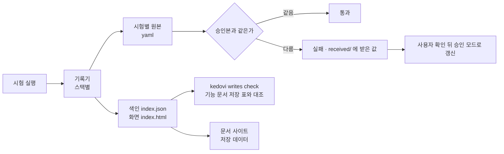

# 쓰기 보고서

시험이 DB 에 무엇을 어떻게 썼는지 DB 화면처럼 테이블 · 행으로 보고, 핵심 테이블은 기대값(승인본)으로 고정한다. 저장 로직을 바꿨을 때 "어느 컬럼에 무슨 값이 들어갔는가" 를 코드를 읽지 않고 확인하는 도구다.

> 형식 정본: 킷의 `packs/core/assets/write-report/FORMAT.md`. 스택별 기록기 · 화면 · 검사는 모두 그 형식만 읽고 쓴다.

## 스택별 기록기

| 스택 | 명령 | 잡는 쓰기 |
|---|---|---|
| Java · jOOQ | `kedovi writes add jooq` | jOOQ 로 실행한 문장 |
| Java · Spring JDBC | `kedovi writes add jdbc` | JdbcTemplate · JPA 등 JDBC 를 거치는 문장 |
| Python · SQLAlchemy | `kedovi writes add sqlalchemy` | 엔진을 거치는 문장 (pytest) |
| Node · pg | `kedovi writes add node-pg` | pg 풀 · 클라이언트 문장 |

- repo 는 스택으로 고른다 (jooq · jdbc = spring, sqlalchemy = fastapi · django · flask, node-pg = express · nestjs). 다르면 `--repo`, 여러 모듈이면 `--dir <모듈>`.
- 있는 파일은 덮지 않는다. 설정 파일은 없는 키만 더한다. 먼저 `--dry-run` 으로 넣을 파일을 본다.
- 끝에 넣을 의존성 · 시험 연결 · 실행 · 기대값 고정 명령이 나온다. 기준 패키지 · 패키지 이름은 `workspace.json` 의 `vars`(`spring.basePackage` · `fastapi.package`).

## 보는 화면

시험을 끝까지 돌리면 출력 폴더에 `index.html` 하나가 생긴다. `kedovi writes open` 이 경로를 찍고 연다.

| 출력 폴더 | 스택 |
|---|---|
| `build/write-report` | Gradle |
| `target/write-report` | Maven |
| `.write-report` | Python · Node |

| 화면에서 보는 것 | 뜻 |
|---|---|
| 시험 목록 | 시험마다 결과(통과 · 실패 · 건너뜀)와 기능 ID |
| 테이블별 쓰기 | INSERT · UPDATE · DELETE · UPSERT 를 실행 순서로, 행은 DB 화면처럼 표 |
| 미기록 | 그 문장이 쓰지 않은 컬럼 (DB 기본값 · 트리거가 채운다) |
| 롤백 | 롤백된 트랜잭션 안의 쓰기 |
| 컬럼 타입 | 처음 쓴 연결에서 읽은 테이블 정의 |

## 기대값 고정

승인본은 **핵심 테이블만** 고정한다. 그 시험이 지키려는 테이블만 고르면 상관없는 변경에 깨지지 않는다.

| 고정 범위 | 시험 하나의 승인본 크기 (측정 예) |
|---|---|
| 그 시험이 쓴 테이블 전부 | 1,500~2,000줄 |
| 핵심 테이블만 | 약 220줄 |

| 단계 | 하는 일 |
|---|---|
| 처음 | 승인 모드로 한 번 돌려 승인본을 만든다. 승인본은 repo 에 커밋한다 |
| 평소 | 승인본과 다르면 시험이 실패하고 받은 값이 `received/` 에 남는다 (메시지에 두 경로와 차이 앞부분) |
| 의도한 변경 | 차이를 사람이 확인한 뒤 승인 모드로 다시 돌린다. Java 는 시스템 속성 `writeReport.approve=true`, Python · Node 는 환경 변수 `WRITE_REPORT_APPROVE=1` |

> 에이전트는 시험을 통과시키려고 승인본을 혼자 바꾸지 않는다. 차이를 보이고 사용자 확인 뒤에만 갱신한다 (backend 팩 「백엔드 쓰기 보고서」 규칙).

## 정규화

실행마다 바뀌는 값은 비교 전에 같은 글로 바꾼다.

| 대상 | 바뀌는 글 |
|---|---|
| DB 가 만든 숫자 ID | `<컬럼-n>` (그 시험 안에서 원값 오름차순 번호) |
| UUID 모양 문자열 | `<uuid>` |
| 지금 시각 컬럼 (`created_at` · `updated_at` 등) · `now()` | `<now>` |
| JSON 문자열 | 키 이름순으로 다시 쓴 것 |
| 오류 메시지의 「Detail:」 이후 | 지움 |

설정 파일(Java `src/test/resources/write-report.properties`, Python · Node `write-report.json`)의 `ids` · `now` · `replace` 로 더하거나 바꾼다.

## 마스킹

| 대상 | 규칙 |
|---|---|
| 이름에 password · token · secret · api_key 등이 든 컬럼 | 값을 `"***"` 로 |
| 컬럼을 모르는 바인드 값 | 기본은 모양만 (`<text:12>` · `<number>` · `<time>`) |
| SQL 로 남기는 문장 | 바인드 · 인라인 값 모두 `?` |

## 제외

| 설정 | 기본 | 뜻 |
|---|---|---|
| `exclude.tables` | 배치 메타 · 스케줄러 · 마이그레이션 기록 · 잠금 테이블 | 통째로 기록하지 않는다 |
| `exclude.updatesOnly` | 없음 | 그 테이블에서 정한 컬럼만 바꾸는 UPDATE 는 개수만 센다 (스케줄러의 다음 실행 시각 등) |

## 저장 표 대조

기획 repo 의 기능 문서는 기능마다 「저장」 표를 둔다. 그 기능이 쓰는 것만 적고, 컬럼 타입 · 설명은 데이터 설계에만 둔다.

| 스키마.테이블.컬럼 | 값 출처 | 조건 | 기본값 |
|---|---|---|---|
| shop.daily_sales.avg_price | shop.orders.amount 의 평균 | 행 없음이면 0 | 0 |

행 삭제는 `스키마.테이블.*`, 저장이 없는 기능은 표 대신 「없음」. `kedovi writes check` 가 보고서와 기능 ID 별로 대조한다. 시험의 기능 ID(수용 기준 ID 포함, 시험 이름 · 태그 · `@spec`)로 기능 절에 묶는다.

| 결과 | 뜻 | 판정 |
|---|---|---|
| 표에 없는 쓰기 | 시험이 썼는데 저장 표에 없는 테이블.컬럼 | 위반 |
| 타입 범위 위험 ✖ | 쓴 값이 numeric(p,s) 자릿수 · varchar(n) 길이를 넘음, 값 출처 컬럼이 대상보다 넓음, DB 오류 22003 · 22001 | 위반 |
| 타입 범위 위험 ⚠ | 한도에 닿음 · 소수 반올림 | 경고 |
| 안 쓴 컬럼 | 저장 표에 있는데 시험이 쓰지 않음 (시험하지 않은 분기일 수 있다) | 경고 |

`--strict` 면 위반이 있을 때 실패로 끝나 CI 에 걸 수 있다. 저장 표와 코드 중 무엇이 맞는지는 기획 문서 규칙의 판정(정본이 맞음 · 구현이 맞음 · 판단 불가)을 따른다.

## 문서 사이트의 저장 데이터

`kedovi docs build` 는 저장 표가 있는 기획 repo 에 메뉴 「저장 데이터」 를 만든다. 기능마다 저장 표 · 시험이 쓴 예시 행 · 보고서 화면 링크가 한 쪽에 모인다.

| 상황 | 쪽 내용 |
|---|---|
| 코드 repo 에 보고서가 있음 | 저장 표 + 예시 행 + 보고서 화면 사본(`write-report/<repo>/`) |
| 보고서 없음 | 저장 표 + 「보고서 없음: kedovi writes add …」 |

> 보고서는 build 때만 새로 읽는다. check · pre-commit 은 사이트에 넣은 사본으로 비교하므로 시험을 다시 돌려도 기획 repo 커밋이 막히지 않는다. Pages 로 올리는 사이트면 시험 데이터(정규화 · 마스킹된 값)도 함께 올라간다. 싫으면 `docs-site.json` 에 `"writeReport": false`.

## 한계

| 한계 | 대신 |
|---|---|
| 시험이 지나간 경로만 보인다 | 안 쓴 컬럼 경고를 보고 시험을 더한다 |
| INSERT SELECT · MERGE · UPDATE FROM · 직접 쓴 SQL 은 행이 아니라 문장으로 남는다 | 화면에서 문장을 직접 본다 (check 는 「컬럼을 모르는 문장」 으로 센다) |
| 병렬 시험은 기록하지 않는다 (구간이 겹치면 실패) | 기록하는 시험 묶음만 직렬로 |
| DB 트리거 · 프로시저 안의 쓰기는 안 보인다 | 그 결과를 조회하는 시험을 둔다 |
| 기록기가 거치지 않는 연결(다른 풀 · 외부 프로세스)은 빠진다 | 시험 문맥의 연결을 쓰게 한다 |
